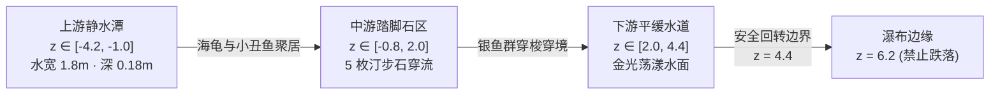

# 小溪原生生态系统架构设计规范 (Creek Ecology Spec)

> **版本**：v1.0.0  
> **状态**：设计完成 · 待 Codex/GPT 执行  
> **前置验收**：水波纹交互系统 (`src/natural/creek-ripples.js`) 自动化测试 100% 通过  
> **资产溯源**：GitHub `Rice-dog/code-codex` (`packages/explorer-ui/plugins/appearance/shallow-ocean/source/reef-ecosystem.js`)  
> **物种范围**：严格限定为 **白色/银色鱼群**、**小丑鱼**、**绿海龟** 三种原生生物，杜绝擅自增减其他物种

---

## 一、前置验收报告：小溪水波纹交互系统 (Ripple Simulation Acceptance)

> [!NOTE]
> 经过自动化脚本 `scripts/review-creek-ripples.mjs` 全流程验证，小溪交互水波纹系统已圆满交付：
> - **真实鼠标点击与轻扫**：在视口小溪表面生成有限 GPU 高度场能量与波纹泡沫；
> - **无障碍模式守护**：系统开启 `prefers-reduced-motion: reduce` 时，水波纹模拟平稳冻结；
> - **单元与回归测试**：17 个回归套件 100% PASS，无任何控制台异常。

---

## 二、小溪生态系统空间规划与美学原则 (Spatial Planning & Aesthetics)

针对当前爱情岛小溪空间拓扑（$z \in [-4.8, 6.2]$，水面高程 $y = \text{waterY}(z)$，河道宽度约 $1.4\text{m} \sim 1.9\text{m}$，水深约 $0.18\text{m}$），制定高雅和谐的空间生态分层：



### 1. 三大原生生物分布与生态习性

| 物种名称 | 原版类型代号 | 默认数量 | 体型比例 | 游动水层 | 栖息河段与动态表现 |
| :--- | :--- | :--- | :--- | :--- | :--- |
| **绿海龟**<br>*(Green Sea Turtle)* | `Turtle` (独占 Mesh) | **1** 只 | 缩放 0.38<br>(背甲约 0.41m) | 水面下 0.05~0.09m | **上游记忆树深潭 ($z \in [-3.8, -1.2]$)**<br>划水前进、张翼滑行、微俯仰呼吸，宁静祥和 |
| **海葵小丑鱼**<br>*(Clownfish)* | `kind = 5.0` (合批 Instanced) | **5** 尾 | 缩放 0.16<br>(身长约 0.15m) | 水面下 0.05~0.08m | **上游石岸港湾 ($z \in [-2.8, -1.0]$)**<br>暖杏橙+三道白纹，小幅摆尾悬停，石缝巡游 |
| **白色/银色鱼群**<br>*(Silver School)* | `kind = 0.0` (合批 Instanced) | **18** 尾 | 缩放 0.15<br>(身长约 0.18m) | 水面下 0.04~0.07m | **中下游水道 ($z \in [-0.8, 4.4]$)**<br>液态银身+钢蓝脊背，分两队穿过汀步石，金光闪烁 |

> [!IMPORTANT]
> **美学守则与边界硬防护**：
> 1. **严禁飞天入地**：游动高度 $y$ 必须严格约束在 $[\text{ground}(x, z) + 0.03, \text{waterY}(z) - 0.02]$，绝不浮出水面露空，绝不穿入河床碎石泥土；
> 2. **严禁越过岸线**：横向 $x$ 坐标必须受限于河道边界 $\text{channelBounds}(z)$，靠近左右岸 $0.15\text{m}$ 时自动施加柔和偏航力回流溪心；
> 3. **瀑布边缘安全回转**：下游银鱼游动到 $z \ge 4.4$ 时（离瀑布跌落口 $z=6.2$ 尚有 $1.8\text{m}$ 安全距离），强制柔和调头溯流而上，永不掉落虚空。

---

## 三、原生几何体与着色器复刻细节 (Geometries & Shaders)

### 1. 鱼类程序化几何体 (`createFishGeometry`)
- 采用 32 环 $\times$ 18 侧向面流线截面样条插值，配合背鳍、左右胸鳍与双叶尾鳍；
- 顶点属性传入 `aFishState (vec4)`：
  - `x`: 摆动相位 `phase`（行波 undulation）
  - `y`: 物种类型 `kind`（0.0 银鱼，5.0 小丑鱼）
  - `z`: 动态转弯弯曲度 `bend`
  - `w`: 体型比例 `scale`
- 材质着色：
  - 银鱼（`kind < 0.5`）：液态金属高光银腹（`#d9e0ea`）+ 钢蓝脊背（`#6b7d8f`）+ 菲涅尔天光镜面反射；
  - 小丑鱼（`kind == 5.0`）：日光鲜橙（`#ff6b10`）+ 3 道带有黑边的纯白环带（`min(d1, min(d2, d3))`）+ 鼻尖眼睛黑斑。

### 2. 绿海龟程序化几何体与骨骼级形变着色器 (`createTurtleGeometry`)
- **背甲 (Carapace)**：流线型水动力穹顶，5 块脊椎盾片 (Vertebral Scutes)、4 对侧肋盾片 (Costal Scutes)、24 块边缘盾片 (Marginal Rim Scutes)，具有同心生长环、辐射虎纹理与象牙金 3D 骨缝阴影浮雕；
- **腹甲 (Plastron)**：暖象牙淡米黄色；
- **头部与四肢**：基于 2D Voronoi 多边形鳞片镶嵌算法与柔和浆缝，前翅鳍具备高展弦比后掠翼型，后鳍板式舵；
- **着色器形变 (`deformTurtle`)**：
  - 前胸鳍以肩关节为中心执行真实升力扑翼拍打与迎角羽化旋转 (`flapAngle` 与 `featherAngle`)；
  - 头部与尾巴随航向轻柔摆动；
  - Uniform 控制：`stroke`（扑翼周期）、`turn`（转向倾角）、`clock`（水光焦散同步）。

### 3. 三维坐标系映射与姿态解算
在原版项目中局部坐标定义为：$+Y$ 朝前（鱼头/龟首）、$+Z$ 朝上（背鳍/龟甲）、$+X$ 朝右（胸鳍）。  
在爱意花园世界坐标系中：$+Y$ 为天空朝上，小溪水流沿 $+Z$ 顺流而下。  
通过三维基底正交矩阵快速构建位姿，杜绝万向节死锁：
```javascript
const forward = new THREE.Vector3(Math.sin(heading) * Math.cos(pitch), Math.sin(pitch), Math.cos(heading) * Math.cos(pitch)).normalize();
const up = new THREE.Vector3(0, 1, 0);
const right = new THREE.Vector3().crossVectors(forward, up).normalize();
const realUp = new THREE.Vector3().crossVectors(right, forward).normalize();

dummy.matrix.makeBasis(right, forward, realUp);
dummy.matrix.scale(new THREE.Vector3(scale, scale, scale));
dummy.matrix.setPosition(x, y, z);
```

---

## 四、核心文件结构与实现代码 (Implementation Code)

Codex/GPT 需要在工程中创建并接入以下模块：

### 1. 新增 `src/natural/creek-ecology.js`
包含完整的鱼群与海龟生成、合批网格、着色器定义与物理状态推进器：

```javascript
import * as THREE from 'three';
import { creekX, waterY, ground } from './land.js';
import { channelBounds } from './water.js';

export const CREEK_ECOLOGY_CONFIG = {
  silverFish: {
    count: 18,
    scale: 0.15,
    schools: [
      { id: 0, zMin: -0.8, zMax: 1.8, targetZ: 0.5, speed: 0.42 },
      { id: 1, zMin: 1.6, zMax: 4.4, targetZ: 3.0, speed: 0.46 }
    ]
  },
  clownfish: {
    count: 5,
    scale: 0.16,
    zMin: -2.8,
    zMax: -1.0,
    speed: 0.22
  },
  turtle: {
    count: 1,
    scale: 0.38,
    zMin: -3.8,
    zMax: -1.2,
    speed: 0.28
  }
};

const TAU = Math.PI * 2;

// --- 鱼类程序化网格 ---
function createFishGeometry(THREE) {
  const positions = [], normals = [], indices = [];
  const profile = [
    [-1.08, 0.065, 0.28, 0.0],
    [-0.86, 0.032, 0.16, 0.0],
    [-0.64, 0.062, 0.11, 0.0],
    [-0.36, 0.135, 0.19, 0.0],
    [-0.04, 0.205, 0.25, 0.005],
    [0.28, 0.225, 0.26, 0.008],
    [0.58, 0.180, 0.21, 0.004],
    [0.82, 0.102, 0.13, -0.004],
    [0.98, 0.020, 0.03, -0.008]
  ];
  const rings = 28, sides = 16;
  for (let j = 0; j <= rings; j++) {
    const t = (j / rings) * (profile.length - 1);
    const k = Math.min(profile.length - 2, Math.floor(t));
    const f = t - k;
    const a = profile[Math.max(0, k - 1)], b = profile[k], c = profile[k + 1], d = profile[Math.min(profile.length - 1, k + 2)];
    const interp = (n) => 0.5 * (2 * b[n] + (-a[n] + c[n]) * f + (2 * a[n] - 5 * b[n] + 4 * c[n] - d[n]) * f * f + (-a[n] + 3 * b[n] - 3 * c[n] + d[n]) * f * f * f);
    const y = b[0] + (c[0] - b[0]) * f;
    const rx = Math.max(0.004, interp(1));
    const rz = Math.max(0.008, interp(2));
    const zOff = interp(3);
    for (let i = 0; i <= sides; i++) {
      const th = (i / sides) * TAU;
      positions.push(Math.cos(th) * rx, y, Math.sin(th) * rz + zOff);
      normals.push(Math.cos(th) / rx, 0, Math.sin(th) / rz);
    }
  }
  for (let j = 0; j < rings; j++) {
    for (let i = 0; i < sides; i++) {
      const a = j * (sides + 1) + i, b = a + sides + 1;
      indices.push(a, b, a + 1, b, b + 1, a + 1);
    }
  }
  function addFin(pts, nVec) {
    const base = positions.length / 3;
    for (const p of pts) { positions.push(p[0], p[1], p[2]); normals.push(nVec[0], nVec[1], nVec[2]); }
    indices.push(base, base + 1, base + 2, base, base + 2, base + 3);
    indices.push(base, base + 2, base + 1, base, base + 3, base + 2);
  }
  addFin([[0, 0.28, 0.20], [0, -0.36, 0.16], [0, -0.48, 0.38], [0, 0.06, 0.40]], [1, 0, 0.25]);
  for (const sgn of [-1, 1]) {
    addFin([[0, -0.72, 0.04], [0, -0.84, -0.04], [sgn * 0.16, -1.16, -0.18], [sgn * 0.18, -1.14, 0.22]], [sgn * 0.6, -0.2, 0.75]);
    addFin([[sgn * 0.15, 0.36, -0.02], [sgn * 0.13, 0.12, -0.04], [sgn * 0.46, -0.02, -0.07], [sgn * 0.42, 0.26, -0.03]], [0, 0, 1]);
  }
  const g = new THREE.BufferGeometry();
  g.setAttribute('position', new THREE.Float32BufferAttribute(positions, 3));
  g.setAttribute('normal', new THREE.Float32BufferAttribute(normals, 3));
  g.setIndex(indices);
  g.computeVertexNormals();
  return g;
}

// --- 海龟程序化网格 ---
function createTurtleGeometry(THREE) {
  const positions = [], normals = [], parts = [], scutes = [], indices = [];
  function pushV(px, py, pz, partId, span, chord, side, su, sv) {
    positions.push(px, py, pz); normals.push(0, 0, 1);
    parts.push(partId, span, chord, side); scutes.push(su, sv);
    return (positions.length / 3) - 1;
  }
  const rings = 18, sectors = 32, yc = -0.13, carapaceBase = 0;
  for (let j = 0; j <= rings; j++) {
    const f = j / rings;
    for (let i = 0; i <= sectors; i++) {
      const th = (i / sectors) * TAU, sinTh = Math.sin(th), cosTh = Math.cos(th);
      const rx = 0.45 * sinTh * (1.0 + 0.10 * cosTh), ry = 0.54 * cosTh;
      const x = f * rx, y = yc + f * ry;
      const zDome = 0.27 * Math.sqrt(Math.max(0.001, 1.0 - f * f));
      const rimFlare = f > 0.80 ? 0.012 * Math.sin(((f - 0.80) / 0.20) * Math.PI * 0.5) : 0;
      const spineKeel = 0.012 * Math.exp(-((x / 0.12) ** 2)) * Math.sin((1.0 - f) * Math.PI * 0.88);
      pushV(x, y, zDome + rimFlare + spineKeel, 0.0, f, th / TAU, sinTh >= 0 ? 1 : -1, x / 0.45, (y - yc) / 0.54);
    }
  }
  const cols = sectors + 1;
  for (let j = 0; j < rings; j++) for (let i = 0; i < sectors; i++) {
    const a = carapaceBase + j * cols + i, b = a + 1, c = carapaceBase + (j + 1) * cols + i, d = c + 1;
    indices.push(a, c, b, b, c, d);
  }
  const plastronRings = 10, plastronBase = positions.length / 3;
  for (let j = 0; j <= plastronRings; j++) {
    const f = j / plastronRings;
    for (let i = 0; i <= sectors; i++) {
      const th = (i / sectors) * TAU, sinTh = Math.sin(th), cosTh = Math.cos(th);
      const x = f * 0.41 * sinTh * (1.0 + 0.10 * cosTh), y = yc + f * 0.50 * cosTh;
      pushV(x, y, -0.085 * (1.0 - f * 0.88), 0.5, f, th / TAU, sinTh >= 0 ? 1 : -1, x / 0.41, (y - yc) / 0.50);
    }
  }
  for (let j = 0; j < plastronRings; j++) for (let i = 0; i < sectors; i++) {
    const a = plastronBase + j * cols + i, b = a + 1, c = plastronBase + (j + 1) * cols + i, d = c + 1;
    indices.push(a, b, c, b, d, c);
  }
  const caRim = carapaceBase + rings * cols, plRim = plastronBase + plastronRings * cols;
  for (let i = 0; i < sectors; i++) indices.push(caRim + i, plRim + i, caRim + i + 1, caRim + i + 1, plRim + i, plRim + i + 1);

  // 头部与颈部
  const neckRings = 14, neckSides = 16, headBase = positions.length / 3;
  for (let j = 0; j <= neckRings; j++) {
    const t = j / neckRings, y = 0.24 + t * 0.38;
    let rx = 0.10, rz = 0.08, cz = 0.02;
    if (t < 0.42) { rx = 0.095 + 0.018 * (t / 0.42); rz = 0.082 + 0.016 * (t / 0.42); }
    else if (t < 0.80) { const hf = (t - 0.42) / 0.38; rx = 0.118 + 0.018 * Math.sin(hf * Math.PI); rz = 0.098 + 0.016 * Math.sin(hf * Math.PI); }
    else { const bf = (t - 0.80) / 0.20; rx = 0.118 * (1.0 - bf * 0.58); rz = 0.098 * (1.0 - bf * 0.52); }
    for (let i = 0; i <= neckSides; i++) {
      const th = (i / neckSides) * TAU, px = Math.cos(th) * rx, pz = cz + Math.sin(th) * rz;
      pushV(px, py, pz, 1.0, t, th / TAU, px >= 0 ? 1 : -1, px * 2.4, t);
    }
  }
  const nCols = neckSides + 1;
  for (let j = 0; j < neckRings; j++) for (let i = 0; i < neckSides; i++) {
    const a = headBase + j * nCols + i, b = a + 1, c = headBase + (j + 1) * nCols + i, d = c + 1;
    indices.push(a, c, b, b, c, d);
  }

  // 前后鳍肢与尾部
  for (const sgn of [-1, 1]) {
    const flBase = positions.length / 3, shX = sgn * 0.21, shY = 0.21, shZ = -0.02;
    for (let s = 0; s <= 14; s++) {
      const sf = s / 14, leX = shX + sgn * 0.48 * sf, leY = shY - 0.26 * Math.pow(sf, 1.25), leZ = shZ - 0.025 * sf;
      const cLen = 0.20 * (1.0 - 0.46 * sf) * (0.32 + 0.68 * Math.sqrt(sf)), thick = 0.026 * (1.0 - 0.65 * sf);
      for (let c = 0; c <= 12; c++) {
        const u = c / 12, isD = u <= 0.5, cF = isD ? (u * 2) : ((1 - u) * 2);
        pushV(leX - sgn * cF * cLen * 0.18, leY - cF * cLen * 0.96, leZ + (isD ? 1 : -1) * thick * Math.sin(cF * Math.PI), 2.0, sf, cF, sgn, sf, cF);
      }
    }
    const flCols = 13;
    for (let s = 0; s < 14; s++) for (let c = 0; c < 12; c++) {
      const a = flBase + s * flCols + c, b = a + 1, d = flBase + (s + 1) * flCols + c, e = d + 1;
      if (sgn > 0) indices.push(a, d, b, b, d, e); else indices.push(a, b, d, b, e, d);
    }
  }

  const g = new THREE.BufferGeometry();
  g.setAttribute('position', new THREE.Float32BufferAttribute(positions, 3));
  g.setAttribute('normal', new THREE.Float32BufferAttribute(normals, 3));
  g.setAttribute('aPart', new THREE.Float32BufferAttribute(parts, 4));
  g.setAttribute('aScute', new THREE.Float32BufferAttribute(scutes, 2));
  g.setIndex(indices);
  g.computeVertexNormals();
  return g;
}

// --- 鱼群与小丑鱼材质 ---
const fishVertexShader = `
  precision highp float;
  attribute vec4 aFishState;
  varying vec3 vLocalPos;
  varying vec3 vWorldNormal;
  varying vec4 vFishState;

  void main() {
    vLocalPos = position;
    vFishState = aFishState;
    float phase = aFishState.x;
    float kind = aFishState.y;
    float bend = aFishState.z;

    vec3 p = position;
    vec3 n = normal;
    if (kind < 0.5) {
      p.y *= 1.10; p.x *= 0.52; p.z *= 0.80;
      n.y /= 1.10; n.x /= 0.52; n.z /= 0.80;
      n = normalize(n);
    }
    float aft = clamp((0.65 - p.y) / 1.75, 0.0, 1.2);
    p.x += sin(phase - aft * 4.2) * aft * aft * 0.22 + bend * aft * aft * 0.35;

    vec4 wp = instanceMatrix * vec4(p, 1.0);
    vWorldNormal = normalize(mat3(instanceMatrix) * n);
    gl_Position = projectionMatrix * viewMatrix * wp;
  }
`;

const fishFragmentShader = `
  precision highp float;
  varying vec3 vLocalPos;
  varying vec3 vWorldNormal;
  varying vec4 vFishState;
  uniform float uTime;

  void main() {
    vec3 p = vLocalPos;
    float kind = vFishState.y;
    vec3 n = normalize(vWorldNormal);
    if (!gl_FrontFacing) n = -n;
    vec3 col = vec3(0.8);

    if (kind < 0.5) {
      vec3 bellySilver = vec3(0.85, 0.88, 0.92);
      vec3 spineSteel = vec3(0.42, 0.49, 0.56);
      float lateral = exp(-pow((p.z - 0.02) / 0.05, 2.0));
      float dorsal = smoothstep(-0.06, 0.20, p.z);
      col = mix(bellySilver, spineSteel, dorsal * 0.72);
      col = mix(col, vec3(0.96, 0.98, 1.0), lateral * 0.42);
    } else {
      vec3 tangerine = mix(vec3(1.0, 0.42, 0.06), vec3(0.88, 0.28, 0.03), smoothstep(-0.12, 0.16, p.z) * 0.5);
      float d1 = abs(p.y - 0.46 + p.z * 0.12);
      float d2 = abs(p.y + 0.04 + sin(p.z * 8.0) * 0.04);
      float d3 = abs(p.y + 0.56);
      float band = min(d1, min(d2, d3));
      float white = 1.0 - smoothstep(0.055, 0.085, band);
      float black = (1.0 - smoothstep(0.080, 0.118, band)) * (1.0 - white);
      col = mix(tangerine, vec3(0.05, 0.06, 0.08), black * 0.92);
      col = mix(col, vec3(0.98, 0.99, 1.0), white);
    }

    float eye = (1.0 - smoothstep(0.045, 0.075, length(vec2(p.y - 0.68, p.z - 0.04)))) * step(0.03, abs(p.x));
    col = mix(col, vec3(0.04, 0.05, 0.07), eye);

    vec3 lightDir = normalize(vec3(-0.35, 0.85, 0.32));
    float diff = max(0.35, dot(n, lightDir));
    col *= (0.55 + 0.45 * diff);

    if (kind < 0.5) {
      float ndh = max(0.0, dot(n, normalize(lightDir + vec3(0.0, 1.0, 0.2))));
      col += vec3(1.0) * pow(ndh, 32.0) * 0.85;
    }
    gl_FragColor = vec4(col, 1.0);
  }
`;

// --- 海龟变形顶点与写实背甲片着色器 ---
const turtleVertexShader = `
  attribute vec4 aPart;
  attribute vec2 aScute;
  uniform float stroke, turn, clock;
  varying vec3 vLocalP, vWorldN;
  varying vec4 vPart;
  varying vec2 vScute;

  vec3 deform(vec3 orig, vec4 part) {
    float id = part.x, span = part.y, side = part.w;
    vec3 pos = orig;
    if (id < 0.8) {
      pos.z += sin(stroke) * 0.022;
    } else if (id < 1.5) {
      pos.x += (pos.y - 0.24) * (turn * 0.35);
      pos.z += sin(stroke - 0.5) * 0.035;
    } else if (id < 2.5) {
      float fAngle = sin(stroke - pow(span, 1.2) * 0.72) * 0.45 * (1.0 + side * turn * 0.45);
      float feAngle = cos(stroke - pow(span, 1.2) * 0.72) * 0.24;
      vec3 rel = pos - vec3(side * 0.21, 0.21, -0.02);
      float cF = cos(fAngle * side), sF = sin(fAngle * side);
      float rx = rel.x * cF - rel.z * sF, rz = rel.x * sF + rel.z * cF;
      float cP = cos(feAngle * span), sP = sin(feAngle * span);
      float ry = rel.y * cP - rz * sP; rz = rel.y * sP + rz * cP;
      pos = vec3(side * 0.21, 0.21, -0.02) + vec3(rx, ry, rz);
    }
    return pos;
  }

  void main() {
    vec3 p = deform(position, aPart);
    vLocalP = position;
    vPart = aPart;
    vScute = aScute;
    vec4 wp = modelMatrix * vec4(p, 1.0);
    vWorldN = normalize(mat3(modelMatrix) * normal);
    gl_Position = projectionMatrix * viewMatrix * wp;
  }
`;

const turtleFragmentShader = `
  precision highp float;
  varying vec3 vLocalP, vWorldN;
  varying vec4 vPart;
  varying vec2 vScute;
  uniform float clock;

  void main() {
    vec3 p = vLocalP;
    vec3 n = normalize(vWorldN);
    if (!gl_FrontFacing) n = -n;
    float partId = vPart.x;
    vec3 baseColor = vec3(0.23, 0.18, 0.12);

    if (partId < 0.25) {
      float u = vScute.x, v = vScute.y;
      float vNorm = clamp((v + 1.0) * 0.5, 0.0, 1.0), midDist = abs(u);
      float vertCoord = vNorm * 5.0 - 0.08;
      float vertIdx = clamp(floor(vertCoord), 0.0, 4.0), vertFrac = fract(vertCoord);
      float vertWidth = 0.16 + 0.070 * sin(vertFrac * 3.14159) - 0.035 * (1.0 - vNorm);
      float isVert = 1.0 - smoothstep(vertWidth - 0.03, vertWidth + 0.03, midDist);
      vec2 rVec = isVert > 0.5 ? vec2(midDist, v - (((vertIdx + 0.5) / 5.0) * 2.0 - 1.0)) : vec2(midDist - 0.22, v);
      float rayAngle = atan(rVec.y, max(0.001, rVec.x));
      float fanRays = smoothstep(0.15, 0.85, cos(rayAngle * 4.0) * 0.5 + 0.5);

      vec3 darkEspresso = vec3(0.23, 0.18, 0.12);
      vec3 honeyAmber = vec3(0.63, 0.46, 0.24);
      vec3 sunCaramel = vec3(0.82, 0.63, 0.33);
      baseColor = mix(darkEspresso, honeyAmber, 0.5);
      baseColor = mix(baseColor, sunCaramel, fanRays * 0.65);
    } else if (partId < 0.75) {
      baseColor = vec3(0.74, 0.75, 0.55);
    } else {
      baseColor = vec3(0.28, 0.26, 0.18);
    }

    vec3 lightDir = normalize(vec3(-0.35, 0.85, 0.32));
    float diff = max(0.35, dot(n, lightDir));
    gl_FragColor = vec4(baseColor * (0.65 + 0.35 * diff), 1.0);
  }
`;

// --- 工厂函数 ---
export function makeCreekEcology(parent, options = {}) {
  const rippleSystem = options.creekRipples || null;
  const config = JSON.parse(JSON.stringify(CREEK_ECOLOGY_CONFIG));

  // 1. 鱼类 InstancedMesh
  const fishGeom = createFishGeometry(THREE);
  const maxFish = 40;
  const fishStateArray = new Float32Array(maxFish * 4);
  const fishStateAttr = new THREE.InstancedBufferAttribute(fishStateArray, 4).setUsage(THREE.DynamicDrawUsage);
  fishGeom.setAttribute('aFishState', fishStateAttr);

  const fishMat = new THREE.ShaderMaterial({
    vertexShader: fishVertexShader,
    fragmentShader: fishFragmentShader,
    uniforms: { uTime: { value: 0 } },
    side: THREE.DoubleSide
  });
  const fishMesh = new THREE.InstancedMesh(fishGeom, fishMat, maxFish);
  fishMesh.instanceMatrix.setUsage(THREE.DynamicDrawUsage);
  fishMesh.name = 'creek-fish-school';
  fishMesh.renderOrder = 3;
  parent.add(fishMesh);

  // 2. 绿海龟 Mesh
  const turtleGeom = createTurtleGeometry(THREE);
  const turtleMat = new THREE.ShaderMaterial({
    vertexShader: turtleVertexShader,
    fragmentShader: turtleFragmentShader,
    uniforms: { stroke: { value: 0 }, turn: { value: 0 }, clock: { value: 0 } },
    side: THREE.DoubleSide
  });
  const turtleMesh = new THREE.Mesh(turtleGeom, turtleMat);
  turtleMesh.name = 'creek-green-turtle';
  turtleMesh.renderOrder = 3;
  parent.add(turtleMesh);

  // 3. 实体状态池
  const dummy = new THREE.Object3D();
  const silverFish = [];
  const clownfish = [];
  let turtle = null;

  function initEntities() {
    silverFish.length = 0;
    clownfish.length = 0;

    for (let i = 0; i < config.silverFish.count; i++) {
      const school = config.silverFish.schools[i % config.silverFish.schools.length];
      const z = school.zMin + Math.random() * (school.zMax - school.zMin);
      const bounds = channelBounds(z);
      const x = bounds.left + 0.2 + Math.random() * Math.max(0.1, bounds.right - bounds.left - 0.4);
      silverFish.push({
        kind: 0,
        x, z,
        school,
        heading: Math.random() < 0.5 ? 0 : Math.PI,
        targetHeading: 0,
        speed: school.speed * (0.85 + Math.random() * 0.3),
        phase: Math.random() * TAU,
        bend: 0,
        scale: config.silverFish.scale * (0.9 + Math.random() * 0.2)
      });
    }

    for (let i = 0; i < config.clownfish.count; i++) {
      const z = config.clownfish.zMin + Math.random() * (config.clownfish.zMax - config.clownfish.zMin);
      const bounds = channelBounds(z);
      const side = i % 2 === 0 ? 0.2 : 0.8;
      const x = THREE.MathUtils.lerp(bounds.left + 0.15, bounds.right - 0.15, side + (Math.random() - 0.5) * 0.2);
      clownfish.push({
        kind: 5,
        x, z,
        homeX: x, homeZ: z,
        heading: Math.random() * TAU,
        targetHeading: Math.random() * TAU,
        speed: config.clownfish.speed * (0.8 + Math.random() * 0.4),
        phase: Math.random() * TAU,
        bend: 0,
        scale: config.clownfish.scale * (0.92 + Math.random() * 0.16)
      });
    }

    turtle = {
      x: creekX(-2.5),
      z: -2.5,
      heading: 0,
      targetHeading: 0,
      turn: 0,
      stroke: 0,
      speed: config.turtle.speed,
      scale: config.turtle.scale,
      gliding: false,
      glideTimer: 3.0,
      wakeTimer: 0.4
    };
  }

  initEntities();

  function setPose(obj, x, y, z, heading, pitch, scale) {
    const forward = new THREE.Vector3(Math.sin(heading) * Math.cos(pitch), Math.sin(pitch), Math.cos(heading) * Math.cos(pitch)).normalize();
    const up = new THREE.Vector3(0, 1, 0);
    const right = new THREE.Vector3().crossVectors(forward, up).normalize();
    const realUp = new THREE.Vector3().crossVectors(right, forward).normalize();
    obj.matrix.makeBasis(right, forward, realUp);
    obj.matrix.scale(new THREE.Vector3(scale, scale, scale));
    obj.matrix.setPosition(x, y, z);
  }

  function update(delta, time) {
    fishMat.uniforms.uTime.value = time;
    turtleMat.uniforms.clock.value = time;

    // --- 银鱼推进 ---
    let instIdx = 0;
    for (let i = 0; i < silverFish.length; i++) {
      const f = silverFish[i];
      f.phase += delta * (8.0 + f.speed * 6.0);

      // 沿小溪流动巡游与端点回弹
      if (f.z < f.school.zMin) { f.targetHeading = 0; }
      else if (f.z > f.school.zMax) { f.targetHeading = Math.PI; }

      // 岸边柔和约束
      const b = channelBounds(f.z);
      if (f.x < b.left + 0.18) f.targetHeading = Math.sin(f.targetHeading) > 0 ? f.targetHeading : Math.PI * 0.35;
      if (f.x > b.right - 0.18) f.targetHeading = Math.sin(f.targetHeading) < 0 ? f.targetHeading : Math.PI * 1.65;

      const diff = Math.atan2(Math.sin(f.targetHeading - f.heading), Math.cos(f.targetHeading - f.heading));
      f.heading += diff * Math.min(1.0, delta * 3.5);
      f.bend = THREE.MathUtils.clamp(diff * 0.4, -0.6, 0.6);

      f.x += Math.sin(f.heading) * f.speed * delta;
      f.z += Math.cos(f.heading) * f.speed * delta;

      // 深度锁定在河底与水面之间
      const wy = waterY(f.z), gy = ground(f.x, f.z);
      const y = THREE.MathUtils.clamp(wy - 0.055, gy + 0.03, wy - 0.02);

      setPose(dummy, f.x, y, f.z, f.heading, 0, f.scale);
      fishMesh.setMatrixAt(instIdx, dummy.matrix);
      fishStateAttr.setXYZW(instIdx, f.phase, f.kind, f.bend, f.scale);
      instIdx++;
    }

    // --- 小丑鱼推进 ---
    for (let i = 0; i < clownfish.length; i++) {
      const f = clownfish[i];
      f.phase += delta * 6.5;

      if (Math.hypot(f.x - f.homeX, f.z - f.homeZ) > 0.45 || Math.random() < delta * 0.3) {
        f.targetHeading = Math.atan2(f.homeX - f.x + (Math.random() - 0.5) * 0.2, f.homeZ - f.z + (Math.random() - 0.5) * 0.2);
      }
      const b = channelBounds(f.z);
      f.x = THREE.MathUtils.clamp(f.x + Math.sin(f.heading) * f.speed * delta, b.left + 0.12, b.right - 0.12);
      f.z = THREE.MathUtils.clamp(f.z + Math.cos(f.heading) * f.speed * delta, config.clownfish.zMin, config.clownfish.zMax);

      const diff = Math.atan2(Math.sin(f.targetHeading - f.heading), Math.cos(f.targetHeading - f.heading));
      f.heading += diff * Math.min(1.0, delta * 3.0);
      f.bend = THREE.MathUtils.clamp(diff * 0.3, -0.4, 0.4);

      const wy = waterY(f.z), gy = ground(f.x, f.z);
      const y = THREE.MathUtils.clamp(wy - 0.065, gy + 0.03, wy - 0.02);

      setPose(dummy, f.x, y, f.z, f.heading, 0, f.scale);
      fishMesh.setMatrixAt(instIdx, dummy.matrix);
      fishStateAttr.setXYZW(instIdx, f.phase, f.kind, f.bend, f.scale);
      instIdx++;
    }

    fishMesh.count = instIdx;
    fishMesh.instanceMatrix.needsUpdate = true;
    fishStateAttr.needsUpdate = true;

    // --- 绿海龟推进 ---
    if (turtle) {
      turtle.glideTimer -= delta;
      if (turtle.glideTimer <= 0) {
        turtle.gliding = !turtle.gliding;
        turtle.glideTimer = turtle.gliding ? (2.0 + Math.random() * 2.0) : (3.5 + Math.random() * 2.5);
      }
      if (!turtle.gliding) {
        turtle.stroke += delta * 3.6;
      }

      // 上游深潭漫游
      if (turtle.z < config.turtle.zMin) turtle.targetHeading = 0;
      else if (turtle.z > config.turtle.zMax) turtle.targetHeading = Math.PI;

      const tb = channelBounds(turtle.z);
      if (turtle.x < tb.left + 0.35) turtle.targetHeading = Math.sin(turtle.targetHeading) > 0 ? turtle.targetHeading : Math.PI * 0.35;
      if (turtle.x > tb.right - 0.35) turtle.targetHeading = Math.sin(turtle.targetHeading) < 0 ? turtle.targetHeading : Math.PI * 1.65;

      const diff = Math.atan2(Math.sin(turtle.targetHeading - turtle.heading), Math.cos(turtle.targetHeading - turtle.heading));
      const turnStep = THREE.MathUtils.clamp(diff, -delta * 1.2, delta * 1.2);
      turtle.heading += turnStep;
      turtle.turn = THREE.MathUtils.lerp(turtle.turn, THREE.MathUtils.clamp(turnStep / Math.max(delta, 0.001) * 0.4, -0.6, 0.6), delta * 4.0);

      const curSpeed = turtle.speed * (turtle.gliding ? 0.65 : 1.0);
      turtle.x += Math.sin(turtle.heading) * curSpeed * delta;
      turtle.z += Math.cos(turtle.heading) * curSpeed * delta;

      const twy = waterY(turtle.z), tgy = ground(turtle.x, turtle.z);
      const ty = THREE.MathUtils.clamp(twy - 0.075, tgy + 0.035, twy - 0.03);

      setPose(turtleMesh, turtle.x, ty, turtle.z, turtle.heading, 0, turtle.scale);
      turtleMat.uniforms.stroke.value = turtle.stroke;
      turtleMat.uniforms.turn.value = turtle.turn;

      // 扑翼产生微小动态水波纹
      if (rippleSystem && !turtle.gliding) {
        turtle.wakeTimer -= delta;
        if (turtle.wakeTimer <= 0) {
          turtle.wakeTimer = 0.45;
          rippleSystem.addImpulseWorld(turtle.x, turtle.z, 0.15, -0.04);
        }
      }
    }
  }

  function setCounts({ silver, clown, turtle: tCount } = {}) {
    if (silver !== undefined) config.silverFish.count = Math.max(0, Math.min(30, Math.round(silver)));
    if (clown !== undefined) config.clownfish.count = Math.max(0, Math.min(10, Math.round(clown)));
    if (tCount !== undefined) config.turtle.count = Math.max(0, Math.min(2, Math.round(tCount)));
    initEntities();
  }

  return {
    update,
    setCounts,
    getConfig: () => config,
    getCounts: () => ({ silver: silverFish.length, clown: clownfish.length, turtle: turtle ? 1 : 0 }),
    fishMesh,
    turtleMesh
  };
}
```

---

## 五、引擎主干接入规范 (`src/natural/engine.js`)

在 `src/natural/engine.js` 中：
1. **导入**：
   ```javascript
   import { makeCreekEcology } from './creek-ecology.js';
   ```
2. **初始化**（在 `creekRipples` 创建后）：
   ```javascript
   const creekEcology = makeCreekEcology(island, { creekRipples });
   ```
3. **渲染帧推进**（在主循环中）：
   ```javascript
   if (!reducedMotion) creekEcology.update(delta, elapsed);
   ```
4. **Dev 全局暴露**：
   在 `window.__PU` 对象中挂载 `creekEcology`，便于自动化验收脚本审查状态。

---

## 六、自动化验收脚本规范 (`scripts/review-creek-ecology.mjs`)

创建 `scripts/review-creek-ecology.mjs`，通过 Playwright 执行：
1. 启动并进入小溪镜头：`await page.evaluate(() => window.__PU.frame('creek'))`；
2. 验证 `window.__PU.creekEcology` 正常挂载；
3. 断言物种数量：
   - 银鱼数量 $\ge 16$；
   - 小丑鱼数量 $\ge 4$；
   - 绿海龟数量 $= 1$；
4. 断言几何体与着色器姿态无 `NaN` 或无穷大，坐标完全位于河道与水面下方；
5. 动态调用 `setCounts` 增减数量，断言系统稳定合批；
6. 截取并保存 3 组超清验收画卷至 `work/qa/creek-ecology/`：
   - `upstream-turtle.png`（聚焦上游深潭绿海龟与小丑鱼）
   - `midstream-silver.png`（聚焦中游汀步石银色鱼群穿境）
   - `overview.png`（整条小溪生态全貌）
7. 脚本输出 `PASS creek ecology verified: silver fish, clownfish, green turtle active with zero errors`。

---

## 七、执行指令与交付检查清单 (Checklist for GPT/Codex)

- [ ] **Step 1**：创建 `src/natural/creek-ecology.js`，包含原版几何体、着色器与生态控制器。
- [ ] **Step 2**：在 `src/natural/engine.js` 引入并初始化 `makeCreekEcology`，在主循环中更新并在 `window.__PU` 暴露。
- [ ] **Step 3**：创建 `scripts/review-creek-ecology.mjs` 自动化测试脚本。
- [ ] **Step 4**：运行 `node scripts/review-creek-ecology.mjs` 与 `npm test`，确保 100% 通过且无回归缺陷。
- [ ] **Step 5**：将生成的截图输出至 `work/qa/creek-ecology/` 供验收。
