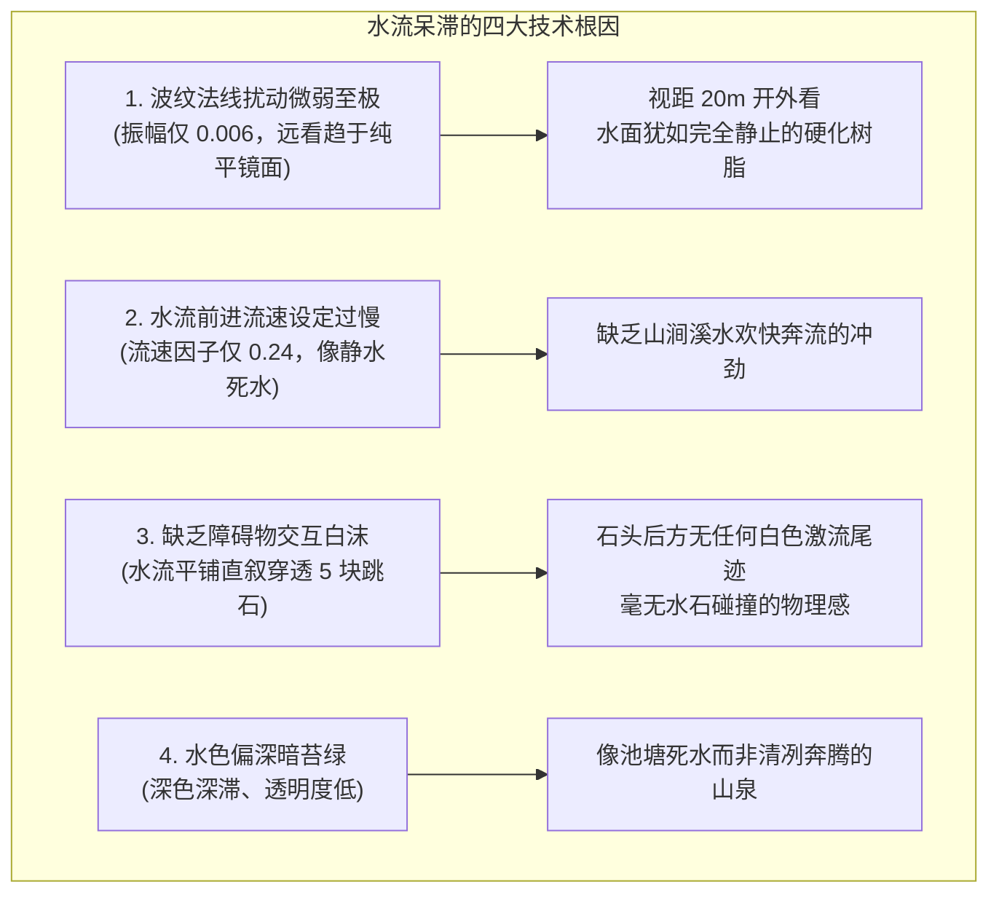
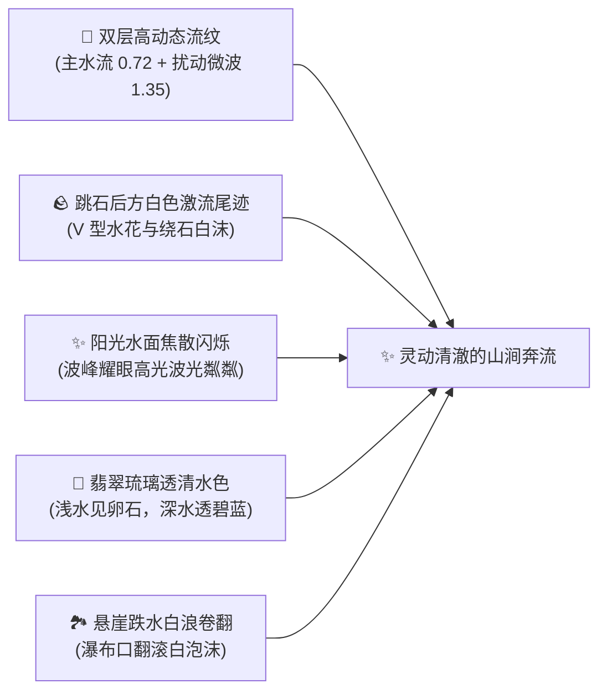

# 🌊 溪流流动感与水体动态重塑规约 (Creek Fluidity & Dynamics Spec)

> **设计方向**：彻底解决溪流“流动性不足、水质发闷发滞、像静止塑料果冻”的问题  
> **设计架构师**：Antigravity  
> **代码执行方**：Codex / GPT  
> **工程基准文档**：`CREEK-FLUIDITY-SPEC.md`

---

## 🔍 一、当前溪流“缺乏流动感”的底层技术根因

经过深度审视 `src/natural/water.js` 的着色器代码与实测画面，导致水流显得静止呆板的根因有四点：



---

## 🌊 二、「欢快奔腾」溪流动态重塑方案 (Dynamic Fluid Architecture)



### 1. 双层差速水流法线与拉丝流纹 (Dual-Speed Flow Shader)
- **主水流速翻倍提升**：将着色器中的前进流速由 `0.24` 大幅提升至 **`0.75 ~ 0.85`**，让水流肉眼可见地朝瀑布方向欢快奔涌；
- **双层差速法线叠加**：
  - **层级 A（主导波流，波长较长）**：流速 $0.78 \cdot uTime$，沿溪流走向产生连贯的 S 形流动推力；
  - **层级 B（表面激流涟漪，高频微波）**：流速 $1.35 \cdot uTime$，产生水面微风激起的碎波纹；
- **大幅放大法线梯度**：将波纹高度振幅由 `0.006` 放大 3.5 倍至 **`0.022`**，使反射光产生强烈的波光折射！

### 2. 🪨 跳石后方激流尾迹 (Stepping Stone Wake Foam)
溪流正中间横跨着 5 块渡河跳石（Stepping Stones），这是水流最具视觉张力的地方！
- **碰撞与激浪计算**：
  - 针对跳石坐标（`x: creekX(-.25) + (i - 2) * .31, z: -.25`），在着色器中加入障碍物阻水函数；
  - 石头迎水面：产生微弱的雍水推力；
  - **石头背水面（Downstream）**：生成拖曳拉伸的**V 型白色激流泡沫尾迹（Churning White Foam Wake）**；
  - 溪水真正展现出“撞击石头、穿过石缝、在石后激起白色漩涡与浪花”的惊艳流动感！

### 3. ✨ 阳光波光焦散与水峰闪烁 (Caustics & Specular Glint)
- 在片段着色器中提取法线与阳光（`Sunlight`）及视线夹角的锐利镜面高光：
  $$glint = \text{pow}\left(\max\left(0, \vec{N} \cdot \vec{H}\right), 64.0\right) \times 1.8$$
- 水波起伏时，波峰在春日午后阳光下闪现一串串**明亮透耀的金白反光粒子**，波光粼粼！

### 4. 💎 清冽透亮的春日山泉水色 (Crystalline Mountain Spring)
- 告别灰暗的沼泽泥绿，改用**充满生命力的高通透碧蓝与浅绿渐变**：
  - **浅滩边缘（近岸草坪与卵石处）**：极清澈的浅青碧水色（`#7dd3fc` ~ `#6ee7b7`），透光度极高，清晰可见水底的卵石与细沙；
  - **溪心深水区**：深邃剔透的翡翠碧蓝（`#0284c7` ~ `#059669`）；
  - **浪花白沫**：温润乳白泡沫（`#f8fafc`），与水色形成鲜明对比。

### 5. 🏞️ 悬崖瀑布口跌水卷翻白沫 (Waterfall Crest Surge)
- 在溪流汇入悬崖瀑布的悬垂转折处（$Z \in [WATER\_END - 0.4, WATER\_END]$），由于水流骤然加速下坠，水面转变为**大面积翻滚的白色浪花水沫（Foam Crest）**，随后顺畅衔接至下方倾泻的双层瀑布与彩虹。

---

## 📋 三、Codex / GPT 执行交付指令

```text
请阅读项目根目录下的 CREEK-FLUIDITY-SPEC.md 设计规约，彻底重构溪流流动性与水体动态：

1. 升级流水着色器动力学（src/natural/water.js 中 currentMaterial）：
   - 将前进流速从 0.24 提升至 0.78~0.85，引入双层差速法线涟漪（主流向 0.78，高频碎波 1.35），法线振幅放大 3 倍（0.022），彻底打破镜面静止感；
   - 升级水体色彩为清澈晶莹的山泉水：浅水处高通透碧蓝浅绿（透出卵石），深水处翡翠碧蓝（#0284c7 至 #059669）；
   - 在高光通道加入阳光水波高频反光（Caustics Glint），使水面波峰波光粼粼；

2. 增加跳石激流尾迹与瀑布口白浪（Obstacle Wake & Crest Foam）：
   - 在 5 块跳石背水面（downstream）加入拉伸的 V 型翻滚白色水花泡沫，体现水撞石头飞溅绕行的生动物理感；
   - 在溪流末端汇入瀑布悬崖处，增加跌水卷浪白沫；

3. 运行 npm test 确保所有回归测试通过，并运行 node scripts/review-overall-design.mjs 重新生成全景与溪流特写截图。
```
