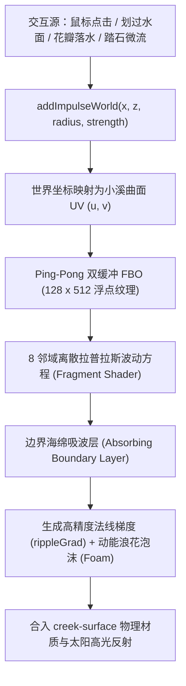

# 🌊 溪流交互式物理水波纹系统设计规约 (Creek Interactive Ripples Spec)

> **设计架构师**：Antigravity  
> **代码执行方**：Codex / GPT  
> **设计基准**：GitHub `Rice-dog/code-codex` (`packages/explorer-ui/plugins/appearance/shallow-ocean/source/water-seabed.js`)  
> **核心目标**：将 `code-codex` 中的 **GPU Height-Field Ripple Simulation** 100% 等效复现在私人花园的浅溪上，适配弯曲水域尺度，实现鼠标轻点荡漾、滑水微澜、踏石涡纹与花瓣落水激荡的电影级物理水面交互。

---

## 🍃 一、核心技术复现与数学架构 (Physics & Mathematics)

在 `Rice-dog/code-codex` 中，水波纹效果之所以灵动真实，是因为它并非简单的正弦波贴图叠加，而是基于 **二维浅水波高度场方程（2D Height-Field Wave Equation）** 的 GPU 实时物理模拟：



### 1. 8 邻域离散拉普拉斯波动方程 (Discrete Laplacian)
在每帧的模拟片段着色器中，利用上下左右及四个对角邻域计算空间曲率：
$$\text{Laplacian} = (h_N + h_S + h_E + h_W) \times 0.20 + (h_{NE} + h_{NW} + h_{SE} + h_{SW}) \times 0.05 - h$$
速度更新与微弱回弹恢复力：
$$v_{new} = v + \text{Laplacian} \times 0.42 - h \times 0.0065$$
高度更新与阻尼衰减：
$$h_{new} = (h + v_{new}) \times \text{damping}$$

### 2. 墨西哥帽脉冲波包注入 (Ricker Wavelet Impulse)
单帧支持注入最多 16 个冲量，波包 profile 采用径向墨西哥帽分布，产生逼真的中心凹陷与环状主峰：
```glsl
float radial = sqrt(dist2 / r2);
float waveProfile = (1.0 - radial * radial * 0.85) * exp(-radial * radial * 0.9);
v += imp.w * waveProfile;
foam = min(1.5, foam + abs(imp.w) * exp(-radial * radial * 1.1) * 0.65);
```

### 3. 吸收边界海绵层 (Absorbing Sponge Layer)
小溪左右岸边与上下游交界处设置海绵阻尼区（`edgeSponge`），水波传至溪岸时柔和消散，杜绝生硬回弹反射。

---

## 📐 二、小溪尺度与坐标系投影映射 (Channel Conformal Mapping)

`code-codex` 原项目是正方形浅海，而我们的小溪是长约 11 米、宽约 1.5 米的弯曲山涧：
- **物理尺寸**：起点 $z = -4.8$，终点 $z = 6.2$（长 11.0m），中心线随 $z$ 轻微弯曲 $x = \text{creekX}(z)$；
- **模拟分辨率**：采用 **$128 \times 512$** 的矩形 Ping-Pong FBO，横向 128 像素覆盖溪宽，纵向 512 像素覆盖全溪流长，纵横比约 1:4，极度贴合航道，开销不到标准 512 正方形纹理的四分之一；
- **$O(1)$ 解析坐标映射**：
  $$\begin{aligned}
  v &= \frac{z - (-4.8)}{6.2 - (-4.8)} = \frac{z + 4.8}{11.0} \in [0, 1] \\
  u &= \frac{x - x_{\text{left}}(z)}{x_{\text{right}}(z) - x_{\text{left}}(z)} \in [0, 1]
  \end{aligned}$$
  无论鼠标点击或花瓣落在何处，瞬间求出对应的水面仿真 UV 坐标。

---

## 🛠️ 三、代码架构与落地模块规划

```
src/natural/
├── creek-ripples.js       # [新增] 核心模块：双缓冲 FBO、波动仿真 Shader、冲量管理与坐标映射
├── water.js               # [改造] 在现有 creek-surface 材质中接入 uRippleSimTex，计算法线与泡沫
└── engine.js              # [改造] 监听鼠标 pointermove / pointerup 与射线检测，向小溪注入涟漪
```

---

## 📜 四、详细实现代码规范 (Implementation Details)

### 1. 新增 `src/natural/creek-ripples.js`

```javascript
import * as THREE from 'three';
import { creekX, waterY, creekWidth, WATER_END } from './land.js';
import { waterBankX } from './water.js';

export function makeCreekRipples(renderer, time) {
  const SIM_W = 128, SIM_H = 512;
  const START_Z = -4.8, END_Z = WATER_END;
  const LENGTH_Z = END_Z - START_Z;

  // 1. Dual-Buffer Ping-Pong Render Targets
  const rtOptions = {
    type: THREE.HalfFloatType,
    format: THREE.RGBAFormat,
    minFilter: THREE.LinearFilter,
    magFilter: THREE.LinearFilter,
    generateMipmaps: false,
    depthBuffer: false,
    stencilBuffer: false,
  };
  let simRT0 = new THREE.WebGLRenderTarget(SIM_W, SIM_H, rtOptions);
  let simRT1 = new THREE.WebGLRenderTarget(SIM_W, SIM_H, rtOptions);

  const MAX_IMPULSES = 16;
  const impulseQueue = [];
  const impulseUniforms = Array.from({ length: MAX_IMPULSES }, () => new THREE.Vector4(0, 0, 0, 0));

  // 2. Coordinate Conversion: World (x, z) <-> UV (u, v)
  function worldToUv(x, z) {
    const v = THREE.MathUtils.clamp((z - START_Z) / LENGTH_Z, 0, 1);
    const left = waterBankX(z, -1);
    const right = waterBankX(z, 1);
    const width = Math.max(0.2, right - left);
    const u = THREE.MathUtils.clamp((x - left) / width, 0, 1);
    return { u, v };
  }

  function addImpulseUv(u, v, radiusUv = 0.035, strength = -0.45) {
    if (impulseQueue.length < MAX_IMPULSES) {
      impulseQueue.push({
        u: THREE.MathUtils.clamp(u, 0.01, 0.99),
        v: THREE.MathUtils.clamp(v, 0.01, 0.99),
        r: THREE.MathUtils.clamp(radiusUv, 0.01, 0.12),
        s: THREE.MathUtils.clamp(strength, -1.2, 1.2),
      });
    }
  }

  function addImpulseWorld(x, z, radiusWorld = 0.28, strength = -0.45) {
    const { u, v } = worldToUv(x, z);
    const rUv = radiusWorld / 1.5; // normalized to channel width
    addImpulseUv(u, v, rUv, strength);
  }

  // 3. Orthographic Simulation Scene
  const simScene = new THREE.Scene();
  const simCamera = new THREE.OrthographicCamera(-1, 1, 1, -1, 0, 1);

  const simMaterial = new THREE.ShaderMaterial({
    uniforms: {
      uPrevState: { value: null },
      uTexel: { value: new THREE.Vector2(1.0 / SIM_W, 1.0 / SIM_H) },
      uImpulses: { value: impulseUniforms },
      uImpulseCount: { value: 0 },
      uDamping: { value: 0.985 },
      uFlowSpeed: { value: 0.024 }, // stream carry
    },
    vertexShader: `
      varying vec2 vUv;
      void main() {
        vUv = uv;
        gl_Position = vec4(position.xy, 0.0, 1.0);
      }
    `,
    fragmentShader: `
      precision highp float;
      varying vec2 vUv;
      uniform sampler2D uPrevState;
      uniform vec2 uTexel;
      uniform vec4 uImpulses[${MAX_IMPULSES}];
      uniform int uImpulseCount;
      uniform float uDamping;
      uniform float uFlowSpeed;

      void main() {
        // Natural stream flow advection: ripples drift slightly downstream
        vec2 advectUv = vUv - vec2(0.0, uFlowSpeed * uTexel.y);
        vec4 cur = texture2D(uPrevState, advectUv);
        float h = cur.r;
        float v = cur.g;
        float foam = cur.b;

        // 8-neighbor discrete Laplacian
        float n  = texture2D(uPrevState, advectUv + vec2(0.0, uTexel.y)).r;
        float s  = texture2D(uPrevState, advectUv - vec2(0.0, uTexel.y)).r;
        float e  = texture2D(uPrevState, advectUv + vec2(uTexel.x, 0.0)).r;
        float w  = texture2D(uPrevState, advectUv - vec2(uTexel.x, 0.0)).r;
        float ne = texture2D(uPrevState, advectUv + vec2(uTexel.x, uTexel.y)).r;
        float nw = texture2D(uPrevState, advectUv + vec2(-uTexel.x, uTexel.y)).r;
        float se = texture2D(uPrevState, advectUv + vec2(uTexel.x, -uTexel.y)).r;
        float sw = texture2D(uPrevState, advectUv + vec2(-uTexel.x, -uTexel.y)).r;

        float avg = (n + s + e + w) * 0.20 + (ne + nw + se + sw) * 0.05;
        float laplacian = avg - h;

        // Velocity evolution with restorative force
        v += laplacian * 0.42 - h * 0.0065;

        // Apply external impulses (Ricker Wavelet)
        for (int i = 0; i < ${MAX_IMPULSES}; i++) {
          if (i >= uImpulseCount) break;
          vec4 imp = uImpulses[i];
          // Account for aspect ratio (SIM_W / SIM_H = 1/4) so ripples remain circular in world space
          vec2 d = (vUv - imp.xy) * vec2(1.0, 4.0);
          float dist2 = dot(d, d);
          float r2 = max(imp.z * imp.z, 0.00004);
          if (dist2 < r2 * 5.0) {
            float radial = sqrt(dist2 / r2);
            float waveProfile = (1.0 - radial * radial * 0.85) * exp(-radial * radial * 0.95);
            v += imp.w * waveProfile;
            foam = min(1.5, foam + abs(imp.w) * exp(-radial * radial * 1.2) * 0.65);
          }
        }

        // Absorbing sponge boundary at riverbanks and waterfall
        float edgeDist = min(min(vUv.x, 1.0 - vUv.x), min(vUv.y, 1.0 - vUv.y));
        float edgeSponge = smoothstep(0.0, 0.065, edgeDist);
        float edgeDamp = mix(0.72, uDamping, edgeSponge);

        h = (h + v) * edgeDamp;
        v *= edgeDamp;
        foam = max(0.0, (foam - 0.004) * 0.985);

        gl_FragColor = vec4(h, v, foam, 1.0);
      }
    `,
  });

  const quad = new THREE.Mesh(new THREE.PlaneGeometry(2, 2), simMaterial);
  simScene.add(quad);

  return {
    worldToUv,
    addImpulseWorld,
    addImpulseUv,
    getTexture() { return simRT0.texture; },
    update(delta) {
      // 1. Pack impulses into uniforms
      const count = Math.min(impulseQueue.length, MAX_IMPULSES);
      simMaterial.uniforms.uImpulseCount.value = count;
      for (let i = 0; i < count; i++) {
        const imp = impulseQueue[i];
        impulseUniforms[i].set(imp.u, imp.v, imp.r, imp.s);
      }
      impulseQueue.length = 0;

      // 2. Ping-Pong Step
      simMaterial.uniforms.uPrevState.value = simRT0.texture;
      const prevRT = renderer.getRenderTarget();
      renderer.setRenderTarget(simRT1);
      renderer.render(simScene, simCamera);
      renderer.setRenderTarget(prevRT);

      // Swap targets
      const tmp = simRT0;
      simRT0 = simRT1;
      simRT1 = tmp;
    },
    dispose() {
      simRT0.dispose();
      simRT1.dispose();
      quad.geometry.dispose();
      simMaterial.dispose();
    }
  };
}
```

---

### 2. 改造 `src/natural/water.js` (接入水波纹法线与泡沫)

在 `currentMaterial(time)` 中增加 `uRippleSimTex` uniform，并在着色器注入点加入采样：

```javascript
// 1. 在 uniforms 中引入:
uRippleSimTex: { value: null },
uRippleStrength: { value: 1.0 },

// 2. 在 vertexShader 中传递规一化流线仿真坐标:
// vSimUv = vec2(vCurrentUv.x, (vCurrentUv.y + 4.8) / 11.0);

// 3. 在 fragmentShader 的 color_fragment 中增加动态泡沫:
vec4 simData = texture2D(uRippleSimTex, vSimUv);
float dynamicFoam = simData.b * uRippleStrength;
float foamAmount = clamp(max(max(wakeFoam, crestFoam), bankFoam) + dynamicFoam * 0.95, 0.0, 1.0);

// 4. 在 normal_fragment_maps 中叠加高度场梯度法线:
vec2 texel = vec2(1.0 / 128.0, 1.0 / 512.0);
float hL = texture2D(uRippleSimTex, vSimUv - vec2(texel.x, 0.0)).r;
float hR = texture2D(uRippleSimTex, vSimUv + vec2(texel.x, 0.0)).r;
float hD = texture2D(uRippleSimTex, vSimUv - vec2(0.0, texel.y)).r;
float hU = texture2D(uRippleSimTex, vSimUv + vec2(0.0, texel.y)).r;
vec2 rippleGrad = vec2(hR - hL, (hU - hD) * 4.0) * 3.2 * uRippleStrength;
normal = normalize(normal - vec3(rippleGrad.x, 0.0, rippleGrad.y));
```

---

### 3. 改造 `src/natural/engine.js` (鼠标指针射线检测与触发)

在 `engine.js` 的 `makeWater` 初始化后挂接 `creekRipples`，并在 `pointerdown` / `pointermove` 中增加对 `creek-surface` 的交互响应：

```javascript
// 当鼠标在小溪上移动或点击时:
const creekSurface = scene.getObjectByName('creek-surface');
const creekHit = raycaster.intersectObject(creekSurface, false)[0];
if (creekHit) {
  // 点击施加较强扩散波纹与小浪花泡沫
  creekRipples.addImpulseWorld(creekHit.point.x, creekHit.point.z, 0.32, -0.55);
}
```

---

## 🛠️ 五、GPT / Codex 执行指令 (Direct Execution Prompt)

请直接复制以下指令交由 GPT / Codex 执行落地：

```markdown
请执行【小溪交互式物理水波纹系统复现】：
1. 创建 `src/natural/creek-ripples.js`，实现规约中完整的 Ping-Pong FBO 仿真与坐标转换；
2. 在 `src/natural/water.js` 中引入 `makeCreekRipples`，将仿真贴图 `uRippleSimTex` 注入 `creek-surface` 着色器法线与泡沫通道；
3. 在 `src/natural/engine.js` 中接入鼠标指针与 `creek-surface` 射线相交检测，并在 `animate` 循环中调用 `creekRipples.update(delta)`；
4. 编写 `scripts/review-creek-ripples.mjs`，通过 Playwright 自动化模拟鼠标点击与划过小溪，验证水波正常生成并保存截图至 `work/qa/creek-ripples/`；
5. 执行 `npm test`，确保全部 17 组回归测试 100% 全绿。
```
