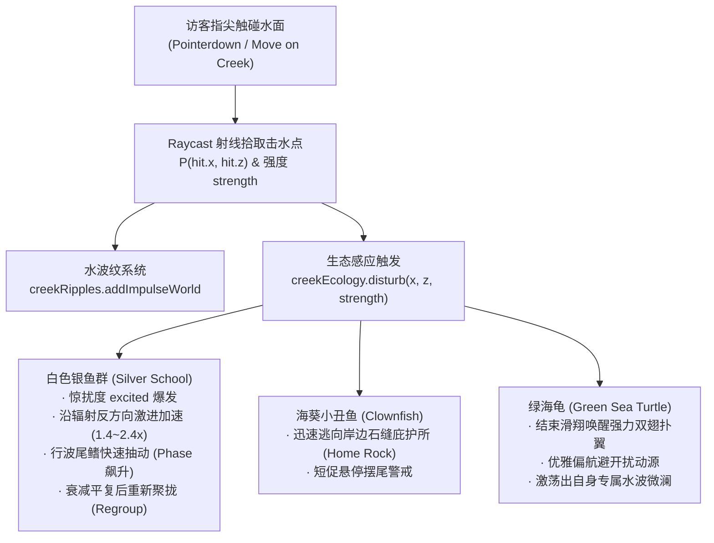

# 🐟 🐢 小溪生灵交互感应与惊扰避障架构设计规范 (Creek Reactive Boids Spec)

> **版本**：v1.0.0  
> **角色分工**：Antigravity 专精**系统架构设计与物理动力学建模**；GPT / Codex 专职负责**代码执行与测试**。  
> **前置系统联动**：小溪交互水波纹 (`creek-ripples.js`) + 小溪原生生态 (`creek-ecology.js`) + 射线拾取系统 (`engine.js`)。  
> **目标**：让水生生灵对访客在水面的轻触、扫掠与击水产生真实物理感应（受惊闪避、快速扑翼、石缝避险与自然聚拢），赋予小溪真实的自然生命力。

---

## 🌊 一、交互感应物理模型与三维动力学 (Physical Mechanics)



---

## 🐠 二、三大原生生灵感应动力学规范 (Entity Behavioral Dynamics)

### 1. 白色/银色鱼群：Boids 惊扰扩散与自然聚拢 (Silver School: Panic Scatter & Regroup)

- **感应半径**：$R_{\text{silver}} = 0.85\text{m} \times (0.7 + \text{strength} \times 0.6)$（点击约为 $1.1\text{m}$，轻划约为 $0.5\text{m}$）。
- **惊扰激发态 (`f.excited`)**：
  - 计算距离 $d = \sqrt{(f.x - x_{\text{hit}})^2 + (f.z - z_{\text{hit}})^2}$；
  - 若 $d < R_{\text{silver}}$，冲击强度 $I = (1 - d / R_{\text{silver}}) \times \min(2.0, \text{strength} \times 2.2)$；
  - $f.\text{excited} = \min(2.5, f.\text{excited} + I)$。
- **瞬时逃逸偏航与速度爆发**：
  - 辐射逃逸角：$\theta_{\text{away}} = \text{atan2}(f.x - x_{\text{hit}}, f.z - z_{\text{hit}}) + (\text{random}() - 0.5) \times 0.35$；
  - 岸线防撞修正：若逃逸方向正对河岸（离左右岸小于 $0.2\text{m}$），速度分量自动沿河道切线偏转，永不上岸；
  - 速度倍增：$v_{\text{active}} = f.\text{speed} \times (1.0 + f.\text{excited} \times 1.5)$；
  - 游动摆尾加速：行波相位增量增加 $f.\text{phase} += \text{delta} \times (8.0 + f.\text{speed} \times 6.0 + f.\text{excited} \times 18.0)$；
  - 身体弯曲（Bend）：转弯时骨骼弯曲度加倍，展现受惊突进时的身体张力。
- **情绪衰减与自然聚拢 (Regroup)**：
  - 惊扰度平缓衰减：$f.\text{excited} = \max(0, f.\text{excited} - \text{delta} \times 1.4)$；
  - 当 $f.\text{excited} < 0.25$ 时，平滑回归鱼群原有的小溪巡弋航向（$f.\text{targetHeading}$ 恢复为流向），并在同群邻居（距离 $< 0.45\text{m}$）之间施加柔和的 Boids 对齐力（Alignment），重组为优雅舒展的小队。

---

### 2. 海葵小丑鱼：石缝避险与谨慎回归 (Clownfish: Cove Retreat)

- **感应半径**：$R_{\text{clown}} = 0.65\text{m}$。
- **避险逻辑**：
  - 小丑鱼具备领地依附性（各自拥有天然石头庇护点 $f.\text{homeX}, f.\text{homeZ}$）；
  - 受惊时不沿河道长距离奔逃，而是**迅速折返向最近的石岸庇护所**；
  - 摆尾频率加快，在石头阴影处悬停警惕；
  - 待 $f.\text{excited}$ 降为 0 后（约 2.5 秒），再次试探性游出觅食。

---

### 3. 绿海龟：沉稳拍翼与自体水波扩散 (Green Turtle: Majestic Wake)

- **感应半径**：$R_{\text{turtle}} = 1.15\text{m}$。
- **沉稳反应**：
  - 绿海龟属于大型沉稳爬行动物，不产生神经质慌乱；
  - 若正在张翼滑翔（`gliding`），立即唤醒进入强力扑翼模式（`turtle.gliding = false; turtle.glideTimer = 3.5;`）；
  - 扑翼速度加快：`turtle.stroke += delta * 6.8;`；
  - 航向平稳偏离扰动点（远离角 $\theta$）；
  - **自体水波激荡**：受惊扑翼时向水波系统注入自身动力波：
    ```javascript
    if (rippleSystem) {
      rippleSystem.addImpulseWorld(turtle.x, turtle.z, 0.22, -0.07);
    }
    ```
    在海龟胸鳍两侧推开清晰的扩散涟漪。

---

## 🛡️ 三、硬性安全与无障碍约束 (Constraints & Accessibility)

> [!IMPORTANT]
> 1. **全物理硬区间约束 (`constrain`)**：
>    - 任何惊扰加速度均在位置更新后强制通过 `constrain()` 函数进行安全校正；
>    - $z$ 轴严格锁定在 $[z_{\text{min}} + \text{margin}, z_{\text{max}} - \text{margin}]$，下游严禁超过 $z = 4.4$，永不跌落瀑布；
>    - $x$ 轴严格限制在河道中央通道 $[\text{bounds.left} + \text{margin}, \text{bounds.right} - \text{margin}]$，永不上岸；
>    - $y$ 轴垂直高度严格锁定在河底与水面之间，绝不飞入空中、绝不穿入碎石。
> 2. **无障碍与低动效模式 (`prefers-reduced-motion`)**：
>    - 在低动效模式下，惊扰加速度与相位激增自动置为 0，保持最舒缓的匀速常态游动。

---

## 💻 四、代码实施规格 (Code Implementation)

### 1. 升级 `src/natural/creek-ecology.js`

在 `makeCreekEcology` 内部增加实体惊扰状态与外部接口：

```javascript
// 在 silverFish 与 clownfish 初始化中增加 excited 属性
// excited: 0

// 新增外部 disturb 方法：
function disturb(x, z, strength = 1.0) {
  const str = THREE.MathUtils.clamp(strength, 0.2, 1.5);

  // 1. 惊扰银鱼群
  const rSilver = 0.90 * (0.7 + str * 0.6);
  for (let i = 0; i < silverFish.length; i++) {
    const f = silverFish[i];
    const dx = f.x - x, dz = f.z - z;
    const dist = Math.hypot(dx, dz);
    if (dist < rSilver) {
      const impulse = (1.0 - dist / rSilver) * Math.min(2.2, str * 2.0);
      f.excited = Math.min(2.5, f.excited + impulse);
      const awayAngle = Math.atan2(dx + (Math.random() - 0.5) * 0.2, dz + (Math.random() - 0.5) * 0.2);
      f.targetHeading = awayAngle;
    }
  }

  // 2. 惊扰小丑鱼
  const rClown = 0.65 * (0.8 + str * 0.4);
  for (let i = 0; i < clownfish.length; i++) {
    const f = clownfish[i];
    const dist = Math.hypot(f.x - x, f.z - z);
    if (dist < rClown) {
      f.excited = Math.min(2.0, f.excited + (1.0 - dist / rClown) * 1.8);
      // 惊扰后逃往石缝庇护所
      f.targetHeading = Math.atan2(f.homeX - f.x, f.homeZ - f.z);
    }
  }

  // 3. 惊扰绿海龟
  if (turtle) {
    const dist = Math.hypot(turtle.x - x, turtle.z - z);
    if (dist < 1.15) {
      turtle.gliding = false;
      turtle.glideTimer = 3.5;
      turtle.targetHeading = Math.atan2(turtle.x - x, turtle.z - z);
      if (rippleSystem) {
        rippleSystem.addImpulseWorld(turtle.x, turtle.z, 0.22, -0.07);
      }
    }
  }
}
```

在 `update(delta, time)` 中接入 `excited` 动力学逻辑：

```javascript
// --- 银鱼群推进 ---
for (let i = 0; i < silverFish.length; i++) {
  const f = silverFish[i];
  f.excited = Math.max(0, (f.excited || 0) - delta * 1.4);

  // 动态速度与相位：受惊时速度爆发 1.4~2.2倍，尾鳍摆频大幅增加
  const currentSpeed = f.speed * (1.0 + f.excited * 1.4);
  f.phase += delta * (8.0 + currentSpeed * 6.0 + f.excited * 16.0);

  // 平复后恢复正常巡航与同群聚拢
  if (f.excited < 0.25) {
    if (f.z < f.school.zMin + 0.45) { f.targetHeading = 0; }
    else if (f.z > f.school.zMax - 0.45) { f.targetHeading = Math.PI; }
    
    // 微弱的同伴对齐引力 (Boids Alignment)
    for (let j = 0; j < silverFish.length; j++) {
      if (i === j) continue;
      const other = silverFish[j];
      if (other.school === f.school && Math.hypot(f.x - other.x, f.z - other.z) < 0.40) {
        f.targetHeading = THREE.MathUtils.lerp(f.targetHeading, other.heading, delta * 0.8);
        break;
      }
    }
  }

  // 岸边柔和约束
  const b = channelBounds(f.z);
  if (f.x < b.left + 0.18) f.targetHeading = Math.sin(f.targetHeading) > 0 ? f.targetHeading : Math.PI * 0.35;
  if (f.x > b.right - 0.18) f.targetHeading = Math.sin(f.targetHeading) < 0 ? f.targetHeading : Math.PI * 1.65;

  const diff = Math.atan2(Math.sin(f.targetHeading - f.heading), Math.cos(f.targetHeading - f.heading));
  const turnSpeed = f.excited > 0.5 ? 6.5 : 3.5;
  f.heading += diff * Math.min(1.0, delta * turnSpeed);
  f.bend = THREE.MathUtils.clamp(diff * 0.45 + (f.excited > 0 ? Math.sin(f.phase) * 0.15 : 0), -0.7, 0.7);

  f.x += Math.sin(f.heading) * currentSpeed * delta;
  f.z += Math.cos(f.heading) * currentSpeed * delta;

  const y = constrain(f, f.school.zMin, f.school.zMax);
  setPose(dummy, f.x, y, f.z, f.heading, 0, f.scale);
  fishMesh.setMatrixAt(instIdx, dummy.matrix);
  fishStateAttr.setXYZW(instIdx, f.phase, f.kind, f.bend, f.scale);
  instIdx++;
}

// 并在 return 对象中导出：
return {
  update,
  disturb,
  setCounts,
  getConfig,
  getCounts,
  dispose,
  fishMesh,
  turtleMesh
};
```

---

### 2. 修改 `src/natural/engine.js`

在 `disturbCreek(event, strength)` 中注入对 `creekEcology` 的调用：

```javascript
function disturbCreek(event, strength){
  if(reducedMotion||phase!=='exploring'||activeDialog||contentEditorOpen||flight||intro||pendingPlacement)return;
  if(strength>-.5&&performance.now()-ripplePointerTime<45)return;
  mouse.set(event.clientX/innerWidth*2-1,-event.clientY/innerHeight*2+1);
  raycaster.setFromCamera(mouse,camera);
  const hit=raycaster.intersectObject(creekSurface,false)[0];
  if(!hit)return;
  const block=raycaster.intersectObjects([...occluders,...interactive],true)[0];
  if(block&&block.distance<hit.distance-.02)return;
  
  creekRipples.addImpulseWorld(hit.point.x,hit.point.z,.20,strength);
  // 联动水生生态感应避障：
  creekEcology?.disturb?.(hit.point.x, hit.point.z, Math.abs(strength));
  
  ripplePointerTime=performance.now();
}
```

---

## 🧪 五、自动化验收测试规范 (`scripts/review-creek-reactive.mjs`)

编写 `scripts/review-creek-reactive.mjs`，通过 Playwright 自动化验证：
1. 镜头定位至小溪中游汀步石视角；
2. 捕获未受惊前的银鱼状态（`f.excited === 0`，记录基准截图 `work/qa/creek-reactive/before-disturb.png`）；
3. 在银鱼聚集中心坐标调用真实鼠标点击；
4. 断言感应生效：
   - 至少 3 尾邻近银鱼 `f.excited > 0.5`；
   - 游速与相位频率显著提升；
   - 捕获惊散峰值截图 `work/qa/creek-reactive/scatter-peak.png`；
5. 等待 2.5 秒情绪自然衰减，断言全部鱼群 `f.excited < 0.05`，重新回归队形；
6. 捕获重整队列截图 `work/qa/creek-reactive/regroup.png`；
7. 全程坐标严格通过 `channelBounds` 与水深断言；
8. 输出 `PASS creek ecology reactive boids scatter and regroup verified with zero errors`。

---

## 📋 六、执行清单 (Checklist for GPT/Codex)

- [ ] **Step 1**：在 `src/natural/creek-ecology.js` 实现 `disturb(x, z, strength)` 方法与 `excited` 动力学逻辑。
- [ ] **Step 2**：在 `src/natural/engine.js` 的 `disturbCreek` 中同步调用 `creekEcology.disturb(...)`。
- [ ] **Step 3**：新建 `scripts/review-creek-reactive.mjs` 自动化测试脚本并运行验证。
- [ ] **Step 4**：运行 `npm test`，确保原有 17 套测试套件继续 100% PASS。
- [ ] **Step 5**：将生成的截图存放在 `work/qa/creek-reactive/` 供验收。
