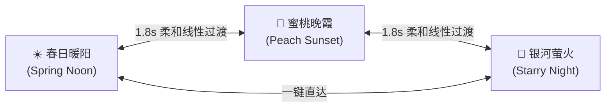

# 🌌 全岛全局昼夜/晚霞/星河全景穿梭架构设计规范 (Global Atmosphere Spec)

> **版本**：v1.0.0  
> **状态**：设计完成 · 待 Codex/GPT 执行  
> **角色分工**：Antigravity 专精**系统架构设计与环境艺术规划**；GPT / Codex 专职负责**代码执行与测试**。  
> **升级核心**：将原仅限在长椅视角的局部氛围切换器，全面解绑并升级为**全岛全局常驻时光系统**。在浮空岛全貌、小溪生态、爱之树、信箱等任意视角均可随心穿梭于【☀️ 春日暖阳】、【🌇 蜜桃晚霞】与【🌙 银河萤火】之间。

---

## 🎨 一、三大全局时光矩阵设计 (The Three Atmospheric Timelines)



### 1. 核心物理光影与次级资产表现

| 维度 | ☀️ 状态一：春日暖阳 (Day) | 🌇 状态二：蜜桃晚霞 (Sunset) | 🌙 状态三：银河萤火 (Night) |
| :--- | :--- | :--- | :--- |
| **主光源 (太阳/冷月)** | `#ffe5c4` / 强度 `3.65`<br>仰角 48° 高悬金白日照 | `#ff8b54` / 强度 `2.95`<br>仰角 8° 贴近地平线暖霞 | `#9ec2f8` / 强度 `0.65`<br>清冷皎洁银辉月光 |
| **半球光 (天光/地光)** | `#edf4fa` / `#60734c` (0.92) | `#9b70a8` / `#454f38` (0.85) | `#162038` / `#0f1814` (0.45) |
| **天空与云层着色** | 蔚蓝春空，白云透金 | 火烧云翻滚，金红至深紫渐变 | 墨蓝天幕接管，深空银河织锦 |
| **深空星月 (`celestial`)** | 不可见 (`opacity = 0`) | 不可见 (`opacity = 0`) | **1240 颗三阶分级恒星呼吸闪烁**<br>(60 颗一等亮星+280 二等星+900 星尘) |
| **夜空流星 (`shooting-stars`)** | 关闭 | 关闭 | **每 15~25 秒划破天际的许愿流星** |
| **母树仙女灯 (`fairy-lights`)** | 熄灭 (`opacity = 0`) | 微弱透出 (`opacity = 0.08`) | **全亮点亮 (`opacity = 1.0`)**<br>枝条缠绕的灯串如星芒般温暖璀璨 |
| **草甸萤火虫 (`fireflies`)** | 隐藏 (`opacity = 0`) | 傍晚苏醒 (`opacity = 0.25`) | **漫天飞舞 (`opacity = 0.95`)**<br>72 只高动态青绿流火在草尖与母树旁漂移 |
| **小溪波光与水生生态** | 澄澈浅青，金白波光闪烁<br>银鱼、海龟清晰畅游 | 泛红铜金色的粼粼碎浪<br>晚霞倒映在涟漪水面 | **幽蓝微光水花 (`#38bdf8`)**<br>夜色下银鱼与海龟穿行在月影微澜中 |

---

## 🖥️ 二、界面交互与显隐逻辑规范 (UI & Visibility Spec)

### 1. 位置与美学排版
- **浮动层级**：居中悬浮于视口底部，正上方距离底栏控制区 `bottom: max(84px, 11vh); left: 50%; transform: translateX(-50%);`；
- **视觉风格**：磨砂毛玻璃质感（`backdrop-filter: blur(8px)`），圆角药丸胶囊结构（`border-radius: 24px`），轻盈雅致。
- **三态按钮**：
  ```html
  <nav id="atmosphere-switcher" aria-label="浮岛时光氛围切换">
    <button type="button" data-atmo="day" aria-pressed="true">☀️ 春日暖阳</button>
    <button type="button" data-atmo="sunset" aria-pressed="false">🌇 蜜桃晚霞</button>
    <button type="button" data-atmo="night" aria-pressed="false">🌙 银河萤火</button>
  </nav>
  ```

### 2. 全局状态响应与自适应显隐
- **显隐守则**：
  - 在探索阶段（`phase === 'exploring'`）且未打开模态框时，**在整座岛屿的全部视角（全景、小溪、母树、信箱、长椅、瀑布）均常驻可见**；
  - 当访客点击白丝带打开相册、打开信箱阅读信件、或打开内容编辑器时，**自动优雅收起隐藏**（`hidden = true`），避免遮挡文本；
  - 关闭阅读弹窗返回花园后，**自动重新浮现**。

---

## 💻 三、代码实施规格 (Implementation Details)

### 1. 修改 `src/natural/engine.js`

#### A. 提升氛围切换器显隐控制
在 `caption(which)` 中，移除原先将切换器局限于长椅的限制：
```javascript
// 修改前：
// $('#atmosphere-switcher').hidden = which !== 'bench';

// 修改后：在任何正常探索视角下均保持可用，弹窗打开时隐藏
function updateAtmosphereVisibility() {
  const panel = $('#atmosphere-switcher');
  if (!panel) return;
  panel.hidden = phase !== 'exploring' || Boolean(activeDialog) || contentEditorOpen || Boolean(pendingPlacement);
}
```
并在 `caption()`、`openPanel()`、`closePanel()`、`showStory()`、`closeStory()` 以及 `returnToGarden()` 中调用 `updateAtmosphereVisibility()`。

#### B. 全局挂载与 API 暴露
在 `window.__PU` 中暴露控制函数，方便编程控制与自动化验收测试：
```javascript
if (import.meta.env.DEV) {
  window.__PU = {
    ...window.__PU,
    setAtmosphere(mode) {
      const button = document.querySelector(`#atmosphere-switcher [data-atmo="${mode}"]`);
      button?.click();
    },
    getAtmosphere() {
      return document.querySelector('#garden-ui').dataset.atmosphere || 'day';
    }
  };
}
```

### 2. 样式微调 `src/style.css`

确保全局展示时的悬浮层级与毛玻璃光泽：
```css
#atmosphere-switcher {
  position: absolute;
  bottom: max(84px, 11vh);
  left: 50%;
  transform: translateX(-50%);
  display: flex;
  gap: 4px;
  padding: 4px;
  border: 1px solid rgba(255, 255, 255, 0.45);
  border-radius: 24px;
  background: rgba(239, 233, 222, 0.88);
  backdrop-filter: blur(8px);
  -webkit-backdrop-filter: blur(8px);
  box-shadow: 0 4px 20px rgba(0, 0, 0, 0.08);
  white-space: nowrap;
  z-index: 10;
  transition: opacity 0.25s ease, transform 0.25s ease;
}
#atmosphere-switcher[hidden] {
  display: none !important;
}
#atmosphere-switcher button {
  border: 0;
  background: transparent;
  border-radius: 20px;
  padding: 8px 14px;
  font: 13px var(--chinese);
  color: #4c463f;
  cursor: pointer;
  transition: background 0.2s ease, color 0.2s ease;
}
#atmosphere-switcher button[aria-pressed="true"] {
  background: #403c46;
  color: #fff5df;
  box-shadow: 0 2px 8px rgba(0, 0, 0, 0.15);
}
```

---

## 🧪 四、自动化验收测试规范 (`scripts/review-global-atmosphere.mjs`)

新建 `scripts/review-global-atmosphere.mjs`，通过 Playwright 驱动自动化验证：
1. **全景全视角覆盖测试**：
   - 在 `hero` 视角切换为 `night`，断言恒星、萤火虫及母树仙女灯点亮；
   - 在 `creek` 视角切换为 `night`，断言小溪波光高光转为 `#38bdf8` 幽蓝冷月色，鱼群与海龟在夜光下正常漫游游弋；
   - 在 `tree` 视角断言仙女灯串 `opacity === 1.0`；
   - 在 `mailbox` 视角切换为 `sunset`，断言晚霞与火烧云着色；
2. **弹窗互斥测试**：
   - 打开白丝带相册时，断言 `#atmosphere-switcher` 自动收起；
   - 关闭相册后，断言 `#atmosphere-switcher` 重新显现；
3. **录屏截图归档**：
   - `work/qa/global-atmosphere/hero-night.png`（全景俯瞰夜色浮岛、萤火与星河）
   - `work/qa/global-atmosphere/creek-night.png`（月光幽蓝小溪、水生生态游弋）
   - `work/qa/global-atmosphere/tree-night.png`（母树仙女灯串特写）
   - `work/qa/global-atmosphere/creek-sunset.png`（晚霞映照溪流金波）
4. 输出：`PASS global atmosphere verified across hero, creek, tree, and mailbox with zero errors`。

---

## 📋 五、执行清单 (Checklist for GPT/Codex)

- [ ] **Step 1**：修改 `src/natural/engine.js`，将 `#atmosphere-switcher` 的显隐解绑为全局可用，并在 `window.__PU` 暴露 `setAtmosphere` 与 `getAtmosphere`。
- [ ] **Step 2**：更新 `src/style.css`，完善胶囊切换器的悬浮与毛玻璃质感。
- [ ] **Step 3**：新建并执行自动化验收脚本 `scripts/review-global-atmosphere.mjs`。
- [ ] **Step 4**：运行 `npm test`，确保原有 17 套测试套件继续 100% PASS。
- [ ] **Step 5**：将验收截图存放在 `work/qa/global-atmosphere/` 供验收。
