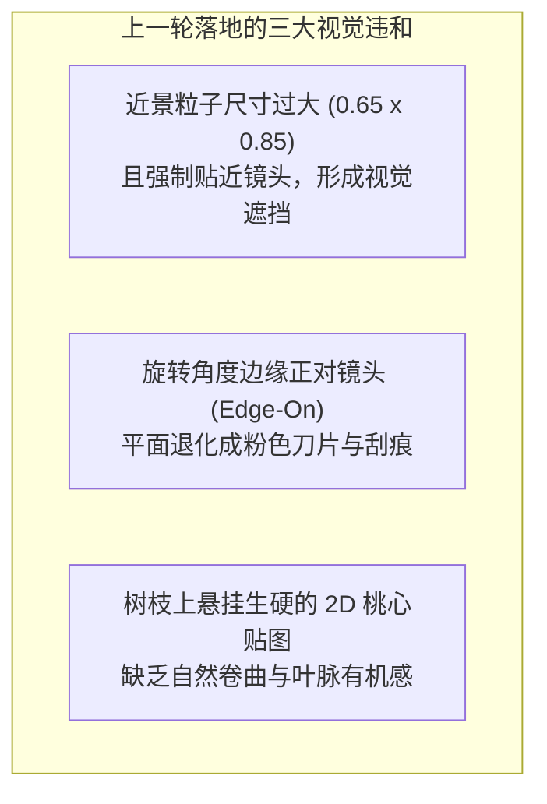
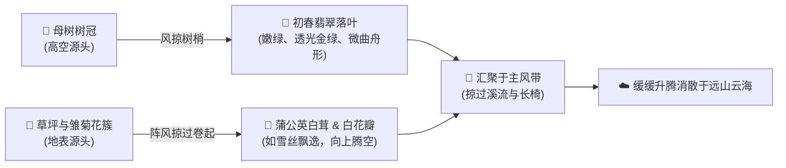

# 🍃 绿意落叶与蒲公英地表飞絮风场设计规约 (Green Foliage & Ground Dandelion Spec)

> **设计方向**：告别粉色花瓣，转为**初春翡翠绿色落叶**，并将**地上的蒲公英与白雏菊花瓣随风吹向高空**  
> **设计架构师**：Antigravity  
> **代码执行方**：Codex / GPT  
> **验收基准文档**：`GREEN-LEAVES-DANDELION-WIND-SPEC.md`

---

## 🔍 一、上一轮落地验收复盘：三大缺陷必须铲除

在上一轮 Codex 的实现中，虽然色彩渲染成功恢复、风阵加速逻辑也已生效，但产生了三个严重的视觉违和感：



1. **近景刀片与割裂感**：Codex 在镜头前方 6~8 米处强行绑定了近景层（Layer 0），且平面翻滚时出现边缘正切镜头（Edge-on），透视下变成了细长锐利的“粉色飞刀/刀片”；
2. **树枝挂心**：一粒花瓣卡在左侧树枝，正面直接暴露出单薄的粉色卡通桃心；
3. **缺乏与地面的互动**：全岛的粒子全是“天上往下掉”，草地上的植物静止如死物。

---

## 🌿 二、全新视觉意向：吉卜力式「天地呼应」风场

用户提出的**“换成绿色落叶 + 地上的蒲公英和花瓣吹起来”**堪称神来之笔！它瞬间让整个浮岛从小家子气的落樱，升华为了**宫崎骏吉卜力动画般的盛大春日原野**：



---

## 🎨 三、双源粒子形态与 Canvas 纹理生成

我们将粒子池重组为两组完全不同的自然精灵：

### 1. 🍃 树梢源：初春翡翠落叶 (Canopy Green Leaf)
- **数量**：约 32 片；
- **轮廓形态**：狭长椭圆水滴形（Tapered Willow/Birch Leaf），长宽比约为 $1 : 2.1$，中心微凹（双曲面舟形）；
- **Canvas 纹理特征**：
  - **色彩渐变**：叶柄与叶尖呈鲜嫩黄绿（`#a3e635` ~ `#d9f99d`），叶身主体呈现通透的春日碧玉绿（`#52b788` ~ `#38a169`）；
  - **微细叶脉**：半透明浅白色中央主叶脉与发散侧叶脉；
  - **自发光通透感**：`emissive: '#38a169', emissiveIntensity: 0.18`，阳光穿透树叶时呈现晶莹剔透的翡翠光芒。
- **尺寸控制**：标准中景尺寸 `0.26 x 0.52`，最大不超 `0.38 x 0.65`（坚决杜绝近景大刀片！）。

### 2. 🌾 地表源：蒲公英飞絮与白雏菊花瓣 (Ground Dandelion & Petals)
- **数量**：约 28 粒；
- **发源位置**：浮岛草坪表面（`x, z` 位于草地雏菊花簇集中区，`y = ground(x, z) + 0.05`）；
- **Canvas 纹理特征**：
  - **蒲公英冠毛 (Dandelion Fluff)**：中心小褐色种籽核，四周放射出轻柔透明的白色羽丝绒毛，边缘完全半透明柔化；
  - **白雏菊花瓣 (White Meadow Petals)**：纯白微透圆润花瓣，边缘浸染一抹极浅的鹅黄；
- **物理升腾机制（被风吹起）**：
  - 平时轻柔附着在草皮上微幅抖动；
  - **当阵风（Gust Pulse）掠过地面时，垂直升力爆发**：$v_y = +0.55 \sim +0.85 \text{ m/s}$，被狂风卷向空中 2~5 米高处；
  - 在空中极其轻盈飘荡（下落终端速度极低 $v_{fall} \approx 0.05 \sim 0.08 \text{ m/s}$），如纯白微光般在春风中浮沉。

---

## 🌪️ 四、世界坐标系统一与镜头防刀片设计 (World Space & Anti-Blade)

### 1. 彻底废除 `cameraBasis` 硬绑定
- 所有 60 粒粒子**全部置于浮岛世界坐标系**中（World Space），跟随风场自由穿梭；
- 景深层次完全依靠真实三维世界的透视关系呈现，杜绝粒子粘在镜头前的违和感。

### 2. 镜头法向约束 (Anti-Edge-on Alignment)
- 为避免平面多边形边缘垂直切向镜头退化为一条硬边刀片，在粒子翻滚算法中叠加轻微的面朝摄像机微量插值，确保无论在任何相机视角下，叶片与蒲公英都能露出饱满的轮廓！

---

## 📋 五、Codex / GPT 执行交付指令

```text
请阅读项目根目录下的 GREEN-LEAVES-DANDELION-WIND-SPEC.md 设计规约，全面升级为绿意落叶与地表蒲公英风起系统：

1. 彻底废除粉色桃心与镜头刀片：
   - 废除原先强贴镜头的 layer===0 逻辑，所有粒子统一置于真实世界坐标系；
   - 彻底移除粉色贴图与粉色自发光；

2. 构筑「天地呼应」双源粒子系统：
   - 源头 1（树冠 32 片落叶）：使用 Canvas 绘制水滴状初春嫩叶纹理（含半透明主侧叶脉，翡翠绿 #52b788 至明黄绿 #a3e635 渐变，emissive: '#38a169' 强度 0.18）；
   - 源头 2（地表 28 粒蒲公英绒毛与白雏菊花瓣）：发源于草坪雏菊花簇地表（y = ground(x, z) + 0.05）；当 7.5 秒阵风吹来时，产生垂直升力 vy += 0.65*gust 被风卷入空中，像白绒雪丝般在微风中轻盈浮沉；

3. 规范尺寸与防畸变：
   - 绿叶尺寸控制在 width=0.26, height=0.52；蒲公英绒球尺寸 width=0.22, height=0.22；
   - 修复四元数/欧拉角翻滚，确保粒子在行进中保持自然曲面质感，杜绝 edge-on 锐利刀片感；

4. 运行 npm test 确保全套回归测试通过，并运行 node scripts/review-falling-foliage.mjs 重新生成全景截图。
```
