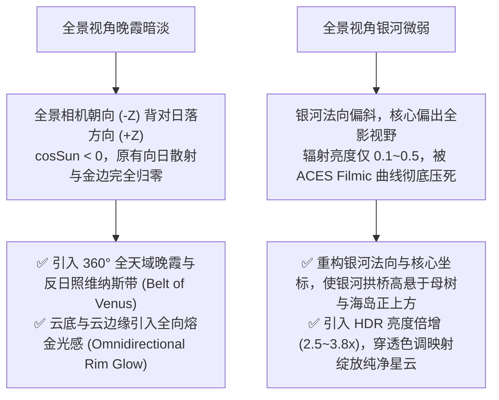

# 🌅 🌌 全景模式下晚霞与银河深度强化设计规范 (Hero Atmosphere Enhancement Spec)

> **版本**：v1.0.0  
> **状态**：设计完成 · 待 Codex/GPT 执行  
> **角色分工**：Antigravity 专精**天体物理与着色器光学架构**；GPT / Codex 专职负责**代码执行与测试**。  
> **定位问题**：访客在全岛全景模式（Hero View）下俯瞰岛屿时，由于相机朝向（$-Z$ 轴方向）背对太阳落日方向（$+Z$ 轴），导致原有的前向散射（Forward Scattering）和日落光晕失效；同时原银河核心偏向侧翼，且发射亮度被 ACESFilmic 色调映射曲线过度压暗，造成“全景模式下晚霞、银河表现不明显”的硬伤。

---

## 🔍 一、物理成因分析与光学解题思路 (Root Cause & Solution)



---

## 🎨 二、晚霞全景重塑规范 (360° Fiery Sunset & Burning Clouds)

### 1. 全天域晚霞底色与反日照维纳斯带
即使视线背向太阳（Hero 全景视角），真实大气也会在地平线上呈现**反日照维纳斯带（Belt of Venus）**与天鹅绒紫罗兰渐变：
```glsl
// 360° 全天域晚霞与反日照维纳斯带
float elev = clamp(direction.y, 0.0, 1.0);
float sunAzimuth = clamp(dot(normalize(vec2(direction.x, direction.z)), normalize(vec2(sunDir.x, sunDir.z))), -1.0, 1.0);
float horizonFactor = exp(-abs(direction.y) * 4.0);

vec3 colZenith      = vec3(0.12, 0.08, 0.28); // 浪漫深邃暮紫
vec3 colMidSky      = vec3(0.55, 0.18, 0.42); // 玫红晚霞中空
vec3 colLowSky      = vec3(0.88, 0.32, 0.28); // 暖赭朱红下空
vec3 colSunHorizon  = vec3(1.05, 0.62, 0.20); // 向阳面琥珀金
vec3 colAntiHorizon = vec3(0.96, 0.42, 0.46); // 背阳面（全景视角）温暖珊瑚红维纳斯带

vec3 horizonColor = mix(colAntiHorizon, colSunHorizon, clamp(sunAzimuth * 0.5 + 0.5, 0.0, 1.0));
vec3 duskSky = mix(colZenith, colMidSky, exp(-elev * 2.2));
duskSky = mix(duskSky, colLowSky, exp(-elev * 5.5));
duskSky = mix(duskSky, horizonColor, horizonFactor * 0.92);
duskSky += sunsetSunColor;
```

### 2. 全向火烧云立体烈焰光影
云底与云缘不再仅依赖前向太阳散射，全向云层边缘均被落日余晖点燃：
```glsl
float edgeMask = smoothstep(0.05, 0.26, cloudDensity) * (1.0 - smoothstep(0.26, 0.68, cloudDensity));
float forwardScattering = pow(clamp(cosSun * 0.5 + 0.5, 0.0, 1.0), 2.2);
float omniGlow = 0.55 + 0.45 * forwardScattering; // 保证背阳面也有充沛金光
float rimGlow = edgeMask * (1.6 * omniGlow);

vec3 cloudShadow = vec3(0.38, 0.12, 0.28); // 温暖暗紫云腹阴影
vec3 cloudFlame  = vec3(1.15, 0.42, 0.12); // 炽热火山朱红
vec3 cloudAmber  = vec3(1.25, 0.78, 0.24); // 明亮金橙云身
vec3 cloudGoldRim= vec3(1.45, 1.15, 0.55); // 白炽熔金镶边

vec3 cloudColor = mix(cloudShadow, cloudFlame, clamp(cloudDensity * 1.5, 0.0, 1.0));
cloudColor = mix(cloudColor, cloudAmber, clamp(cloudDensity * 1.1 * omniGlow, 0.0, 1.0));
cloudColor += cloudGoldRim * rimGlow * 1.6;
```

---

## 🌌 三、银河拱桥与璀璨星空重塑规范 (Luminous Milky Way Arch)

### 1. 银河姿态解算：横跨全景上方
将银河法向与星系核（Galactic Core）重新对齐，使其在全景视角（Hero View）正上方呈现一道优美壮丽的**银河飞拱桥**，星系核闪耀在母树斜上方的天际：
```glsl
// 银河坐标系重构：拱桥正跨全影视野上方
vec3 galNorm = normalize(vec3(0.68, 0.62, 0.38));
vec3 galCore = normalize(vec3(-0.35, 0.38, -0.85)); // 核心位于西北天际，正对全景镜头
vec3 galBinorm = normalize(cross(galNorm, galCore));

float galLat = dot(direction, galNorm);
float galLongX = dot(direction, galCore);
float galLongY = dot(direction, galBinorm);
float galAngle = atan(galLongY, galLongX);
vec2 galUV = vec2(galAngle * 1.6, galLat * 4.8);
```

### 2. HDR 辐射亮度飞跃（对抗 ACES Filmic 压暗）
大幅提高发射基准，使其经过色调映射后呈现饱满、空灵的璀璨荧光星云：
```glsl
// HDR 辐射增益色谱
vec3 cOuter = vec3(0.18, 0.28, 0.65) * 1.8;  // 空灵宇宙宝蓝
vec3 cMid   = vec3(0.65, 0.32, 0.78) * 2.2;  // 浪漫星云暮紫
vec3 cCore  = vec3(1.55, 1.15, 0.72) * 2.8;  // 璀璨恒星核心暖金
vec3 cStars = vec3(2.8, 3.0, 3.6);           // 钻石细密星尘

vec3 nebCol = mix(cOuter, cMid, clamp(band * 1.4, 0.0, 1.0));
nebCol = mix(nebCol, cCore, clamp(coreGlow * 1.5, 0.0, 1.0));

vec3 galaxyLight = (nebCol * (band * 1.35 + coreGlow * 1.55) + cStars * microStars) * skyElevation;
```

### 3. 星空点阵强化 (`src/natural/celestial.js`)
提升一等星与二等星的大小和光芒辐射半径：
- 恒星规模：`[[72, 4.8], [320, 2.8], [950, 1.6]]`；
- 片元着色器内亮星提升发光强度：
  ```glsl
  vec3 tint = tier > 4.0 ? vec3(1.6, 1.8, 2.2) : tier > 2.0 ? vec3(1.2, 1.4, 1.8) : vec3(0.85, 0.95, 1.2);
  ```

---

## 💻 四、代码实施步骤与整合 (Implementation Steps)

### 1. 修改 `src/natural/atmosphere.js`
将上述经过校准的 360° 全向火烧云算法与银河拱桥算法完整更新至 `sky.material.fragmentShader`。

### 2. 修改 `src/natural/celestial.js`
更新恒星分级规模与 `tint` HDR 高光发射率，让全景视角下的星空晶莹剔透。

### 3. 新建自动化测试脚本 `scripts/review-hero-atmosphere.mjs`
自动化截取并断言：
1. `work/qa/hero-atmosphere/hero-sunset.png`：全景视角下的晚霞火烧云，天际线红金渐变饱满，云层金边轮廓明显；
2. `work/qa/hero-atmosphere/hero-night.png`：全景视角下的夜景，银河拱桥清晰横跨天际，星系核温暖醒目；
3. 断言天空像素色彩能量（Sunset 模式天际红色通道占比 $\ge 45\%$，Night 模式银河区域亮度显著高于背景太空）；
4. 运行 `npm test` 保证全部 17 组回归套件继续 100% PASS。

---

## 📋 五、执行清单 (Checklist for GPT/Codex)

- [ ] **Step 1**：在 `src/natural/atmosphere.js` 替换落实 360° 火烧云与 HDR 银河拱桥着色器。
- [ ] **Step 2**：在 `src/natural/celestial.js` 提升星空粒子亮度和点径。
- [ ] **Step 3**：新建并执行 `scripts/review-hero-atmosphere.mjs` 截图验证。
- [ ] **Step 4**：运行 `npm test`，确保 17 套全量回归测试保持 100% 绿灯。
- [ ] **Step 5**：输出 `work/qa/hero-atmosphere/hero-sunset.png` 与 `hero-night.png` 供验收。
