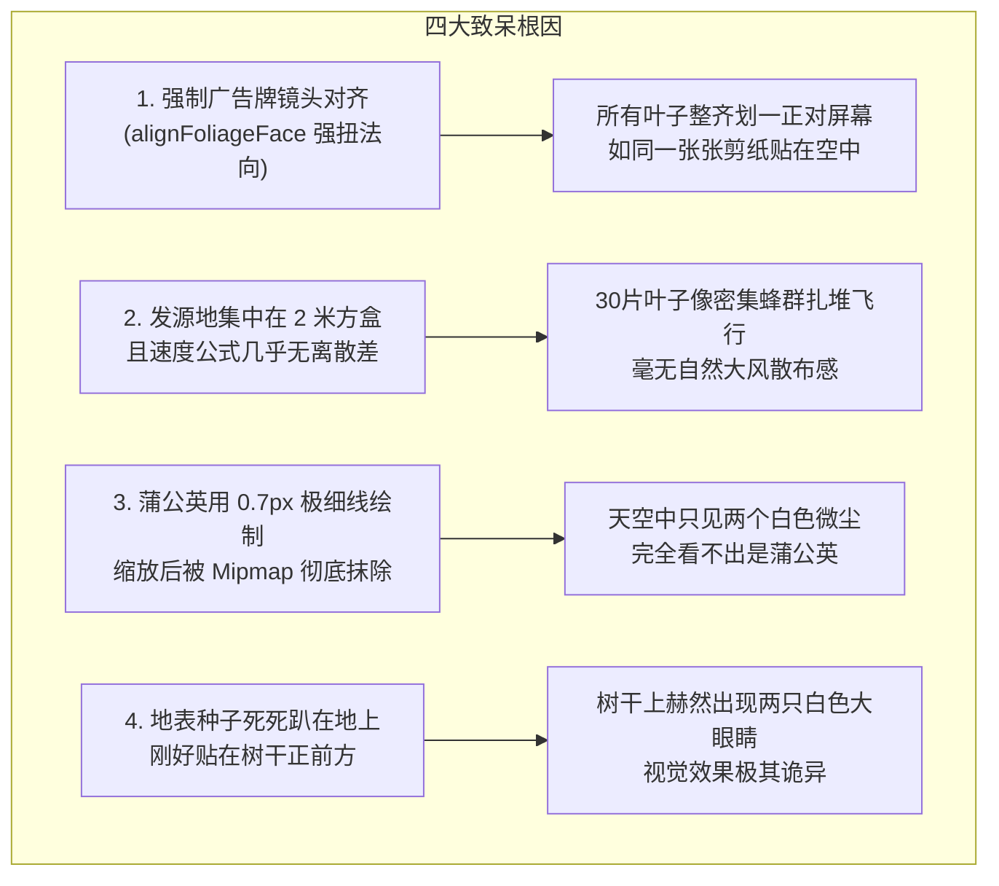

# 🌾 设计验收与「极致生动」重塑规约 (Lively Meadow Foliage & Dandelion Spec)

> **验收结论**：⚠️ **部分达标，但生动度严重不足 (NEEDS POLISH)**  
> **核心痛点**：蜂群式并排扎堆、贴图强制正对镜头如同 2D 贴纸、树干惊现两只白色大眼珠、蒲公英线条过细近乎隐形、缺少自然灵动感。  
> **设计架构师**：Antigravity  
> **代码执行方**：Codex / GPT  
> **重构执行文档**：`LIVELY-MEADOW-WIND-SPEC.md`

---

## 🔍 一、为什么“感觉不够生动”？底层根因透视

经过核验 Codex 生成的代码与全景截图（[`ambient-garden.png`](file:///C:/Users/Administrator/.gemini/antigravity/brain/c9c5605b-e177-44be-bdff-6d0f7d74eb16/ambient-garden.png) 与 [`wind-ribbon-tree.png`](file:///C:/Users/Administrator/.gemini/antigravity/brain/c9c5605b-e177-44be-bdff-6d0f7d74eb16/wind-ribbon-tree.png)），画面呆板的根因非常明确：



1. **“强制朝向镜头”抹杀了 3D 翻滚灵魂**：  
   Codex 为了防止出现刀片，写了一个 `alignFoliageFace` 函数，强行将粒子的法线扭向摄像机！这导致所有落叶**无论怎么飞，正面都死死瞪着屏幕**，就像在屏幕上漂浮的 2D 贴纸，完全丧失了落叶在三维空间中“翻跟头（Tumble）、侧身迎风（Roll）、随风自旋（Pitch）”的灵动美；
2. **蜂群并排扎堆**：  
   落叶的初始位置全部挤在 `x: -2.5, z: 1.2` 附近极小的 2 米空间内，且每片叶子的水平推力速度公式完全一致，导致它们像“一队受过阅兵训练的绿蜂”整整齐齐地往前飞；
3. **蒲公英贴图线条过细（0.7px）**：  
   Canvas 绘制时采用了极细的发丝线条。在 3D 空间下，经抗锯齿与 Mipmap 过滤后，细线直接消失，只剩下一个极淡的黑点，肉眼根本看不到蒲公英的蓬松感；
4. **树干惊现“两只白色大眼珠”**：  
   因为地表种子被硬编码设置在 `[-3, -2]` 的草坪点位上，在未起飞时正巧贴在母树树干的正面，看起来就像母树长了一对诡异的白色大眼睛！

---

## 🍃 二、「极致生动」四大重构策略 (Lively Mechanics)

### 1. 废除 `alignFoliageFace`，回归自由 3D 空气动力翻滚
- **彻底删除强制面朝镜头的代码**；
- 赋予每片叶子独立的翻滚三轴角速度：
  - **翻跟头 (Somersault Pitch)**：沿风向以自然速度向前翻转；
  - **左右钟摆飘摇 (Rocking Roll)**：振幅 $30^\circ \sim 60^\circ$；
  - **螺旋偏航 (Yaw Drift)**：随风向轻微偏转；
- 双面微弯曲面在受阳光照耀时，叶面受光与背阴交替闪烁，这才是真实的落叶波光！

### 2. 全树冠立体发源与速度离散（瓦解蜂群，化作风之轨迹）
- **发源范围扩大 3 倍**：遍布母树整个树冠（$X \in [-4.5, 0.5], Y \in [3.8, 7.8], Z \in [-1.2, 3.2]$）；
- **参数随机离散化**：
  - 速度离散度提升：每片叶子基准速度各不相同（$\pm 40\%$ 差异）；
  - 飞行轨迹呈现**宽广、蜿蜒的 S 形自然气流**，从树梢高低错落飘过溪流与长椅，不再扎堆成团。

### 3. 梦幻柔羽发光蒲公英球 (Luminous Fluff Tuft)
摒弃显微镜式的单像素细线，改为**吉卜力动画同款的蓬松透光白羽光球**：
- **Canvas 贴图绘制**：
  - 中央底部：微小深褐种籽；
  - 羽毛冠毛：**放射状柔化白色羽丝 + 边缘半透明羽化晕染**（带有柔和的 Radial Glow 辉光）；
  - 加入柔和自发光微光（`#ffffff`，强度 0.28）；
  - 当阳光照耀时，犹如随风飘舞的小小发光精灵，辨识度拉满！

### 4. 彻底消除树干眼睛（地表隐匿与风起唤醒）
- 地表蒲公英和白花瓣在静止状态（`airborne === false`）时，**透明度（opacity）降为 0 或潜藏在草丛中**；
- **只有在阵风吹过草地的那一刻，它们才伴随着向上的升力，从草丛深处旋转腾空飞出**，飞向蓝天！彻底杜绝静态贴在树干上的尴尬。

---

## 📋 三、Codex / GPT 执行交付指令

```text
请阅读项目根目录下的 LIVELY-MEADOW-WIND-SPEC.md 设计规约，彻底解决落叶与蒲公英“呆板不够生动”的问题：

1. 彻底废除 alignFoliageFace 强制镜头对齐：
   - 彻底移除 alignFoliageFace 函数调用，禁止强制将粒子法向扭向相机；
   - 恢复真正的自由 3D 空气动力学三轴翻滚：每片叶子拥有独立的 Somersault（翻跟头）、Rocking（左右飘摇）与 Yaw（风向偏转）周期，翻滚时自然映射阳光反光；

2. 瓦解“蜂群扎堆”，实现全树冠散漫风道：
   - 树冠发源地扩大至 x: [-4.5, 0.5], y: [3.8, 7.8], z: [-1.2, 3.2]，避免所有叶子挤在同一小格；
   - 每片叶子的移动速度、升力和阻力引入 30%~40% 的随机离散，形成高低错落、前后连贯的飘逸气流带；

3. 重绘梦幻发光蒲公英绒球（吉卜力同款）：
   - 在 createFoliageTexture 中，彻底放弃 0.7px 单像素细线；
   - 改为绘制蓬松柔化的白色羽毛伞（带柔和外圈辉光 Radial Blur，中心小种籽），并赋予 emissive: '#ffffff'（强度 0.28），使其在空中宛如发光飞羽般清晰可辨；

4. 彻底消除“树干大白眼”Bug：
   - 地表蒲公英在未起飞（!p.airborne）时，设置 fade=0（或不渲染），仅在阵风吹起时从草丛中扬起升腾；

5. 运行 npm test 确保所有回归测试通过，并运行 node scripts/review-falling-foliage.mjs 更新全景截图。
```
