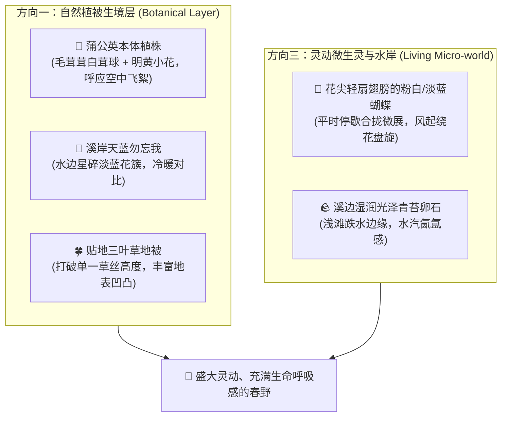

# 🌾 草坪细节丰富化设计规约：自然植被与灵动微生灵系统

> **设计方向**：方向一（自然生态植被）+ 方向三（灵动微生灵与水岸细节）  
> **设计架构师**：Antigravity  
> **代码执行方**：Codex / GPT  
> **工程基准文档**：`MEADOW-ENRICHMENT-SPEC.md`

---

## 🍃 一、设计意向与生态拓扑 (Artistic Direction)

本次升级旨在彻底告别“高尔夫球场式的单调草皮”，将浮岛打造成**充满自然呼吸感与微生命互动的吉卜力式春日原野**：



---

## 🎨 二、模块细节与渲染参数设计 (Component Specifications)

### 1. 🌾 蒲公英实体植株 (Dandelion Seedheads & Golden Flowers)
- **生态分布**：在母树迎风草坪、小溪两岸及长椅后方形成 3~4 个小型家族聚落（如坐标 `[-4.5, 1.8]`, `[1.2, -1.8]`, `[5.0, 1.2]`），共约 30~45 株；
- **形态与材质组合**：
  - **白茸种球（成熟体，约 60%）**：
    - 直径 0.16~0.22 的半透明发光绒球（由细致多角微星芒几何体或半透明曲面组合）；
    - 材质：柔和纯白 `#ffffff`，开启双面半透明（`opacity: 0.88, roughness: 0.8`），微弱自发光 `emissive: '#ffffff'`（强度 0.22），阳光穿透时晶莹温润；
  - **金黄小花（初绽体，约 40%）**：
    - 直径 0.12~0.15 的多层辐射小花瓣，鲜嫩金黄（`#ffb703` ~ `#fdc500`）；
  - **茎秆**：纤细青绿花茎（高 0.22~0.35），带柔和微弯弧度；
- **风动响应**：接入主风场微摆，阵风来时摇摆幅度加大，仿佛正源源不断向天空释放白羽！

### 2. 💙 溪岸天蓝勿忘我 (Forget-Me-Nots by the Creek)
- **生态分布**：沿小溪两岸湿润土坡（距离水线 0.25~0.6 米）错落延伸分布，约 120~180 朵；
- **形态与材质**：
  - 五瓣星形精致小花（直径 0.08~0.11，高 0.16~0.22）；
  - **色彩配比**：纯净透亮的天空琉璃蓝（`#48cae4` / `#00b4d8`），中央带有米粒大的金黄微凸花心（`#ffe066`）；
  - 与碧绿的小溪水体和绿草形成强烈的冷暖衬托，视觉层次极大丰富。

### 3. 🍀 贴地三叶草被与浅草斑 (Clover Mats)
- 贴地匍匐的心形三叶微草簇（高度仅 0.05~0.08），点缀在母树根系与长椅脚边，打破原先千篇一律的单一草叶高度。

### 4. 🦋 灵动蝴蝶精灵 (Fluttering Butterflies)
- **数量与角色**：**2 只精灵小蝶**（纯白粉蝶 1 只 + 琉璃淡蓝蝶 1 只）；
- **极简高性能建模**：
  - 每只蝴蝶由微型身体 + 左右两个轻微内曲的贝塞尔翅面组成（总面数 < 60 面，开销极低）；
  - 材质：柔和双面半透明，边缘带有自然微晕渐变；
- **生动行为状态机**：
  - **停歇扇翅态 (Perching 80% 时间)**：停在勿忘我或雏菊的花瓣上，双翅以 1.2Hz 节奏轻轻合拢与展开（夹角在 $15^\circ \sim 75^\circ$ 间呼吸）；
  - **飞舞盘旋态 (Flight 20% 时间)**：当 7.5s 强阵风吹拂（`gust > 0.4`）或玩家鼠标指针划过花丛时，被风轻柔惊起，沿一条平滑螺旋曲线（半径 0.8~1.5m，高度 0.3~1.2m）轻盈飞舞 3~4 秒，随后温柔落在附近的另一朵花上。

### 5. 🪨 溪流浅滩湿润青苔卵石 (Mossy Riverbed Pebbles)
- **位置**：在溪流转角、跌水石阶和浅滩两岸点缀 10~15 颗圆润卵石（直径 0.15~0.32）；
- **水汽氤氲质感**：
  - 靠近水线的石头材质调低粗糙度（`roughness: 0.16`），呈现刚刚被溪水溅湿的高光反光；
  - 石顶与背阴侧覆盖深浓苍翠的丝绒青苔（`#2d6a4f`）。

---

## 🏗️ 三、工程性能与无障碍规范

1. **Draw Call 合批控制**：
   - 勿忘我小花、蒲公英花球与卵石分别使用 `THREE.InstancedMesh`，单类型单 Draw Call，总面数严格控制在 8000 面以内；
2. **休眠保护**：
   - 打开信箱、照片相册等阅读弹窗时（`covered === true`），蝴蝶飞行与风动计算立即冻结，保障 60fps 翻页；
3. **无障碍兼顾**：
   - 在 `reducedMotion`（减弱动态）模式下，蝴蝶静止停歇在花尖，水草保持微风柔度。

---

## 📋 四、Codex / GPT 执行交付指令

```text
请阅读项目根目录下的 MEADOW-ENRICHMENT-SPEC.md 设计规约，为浮岛草坪注入自然生态与生灵细节：

1. 新增溪岸天蓝勿忘我与蒲公英实体植株（src/natural/plants.js）：
   - 蒲公英植株：35 株，包含毛茸白茸球（半透明纯白发光，emissive: #ffffff 0.22）与鲜嫩金黄小花（#ffb703），分布于母树旁与长椅后方草地；
   - 勿忘我花簇：150 朵，采用天空琉璃蓝（#48cae4）配合金黄花心，沿小溪两岸湿润土坡蜿蜒点缀；
   - 溪流青苔卵石：在溪岸浅滩增加 12 颗湿润反光（roughness: 0.16）与带深绿青苔的圆润小卵石；

2. 新增灵动蝴蝶系统（src/natural/butterflies.js 或集成进 plants.js）：
   - 构造 2 只轻量粉白与淡蓝蝴蝶，常态停歇在花尖微扇翅膀（1.2Hz 呼吸）；
   - 在 7.5 秒强阵风吹来时，触发螺旋盘旋起舞逻辑，绕花丛飞舞 3~4 秒后优雅降落；并在弹窗遮罩时休眠；

3. 运行 npm test 确保所有回归测试与仪式感测试通过，并运行 node scripts/review-overall-design.mjs 刷新验收截图。
```
