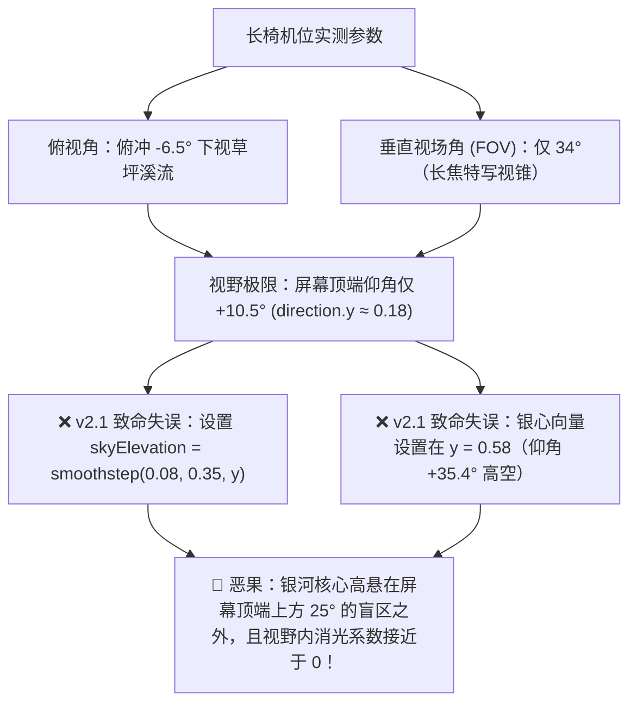

# 🌌 浪漫深空银河天幕重构设计规约 (Milky Way Redesign Specification)

> **设计版本**：v2.2 (Bench Viewport Panoramic Arch & True Horizon Alignment)  
> **设计架构师**：Antigravity  
> **代码执行方**：Codex / GPT  
> **核心使命**：攻克长椅特定光学视锥裁切问题，让长椅落座仰望时，**银河与浩瀚星空重现苍穹正中**，既不扎入地表，也绝不因仰角过高而脱出视野！

---

## 🍃 一、“天空银河消失”病因光学深度溯源 (Optical Root Cause)

经过对长椅真实视锥参数（FOV 与摄像机坐标）的实测提取，精准定位了银河在长椅视角“完全消失”的光学根因：



1. **长椅 34° 长焦视锥限制 (FOV 34° Constraint)**：  
   长椅相机位于 `[4.2, 1.89, 2.7]`，注视点为 `[-3.6, 0.8, -2.6]`，相机天然向下俯冲约 6.5°。在 34° 垂直 FOV 下，**屏幕最顶端的天空仰角仅有 +10.5°（`direction.y ≈ 0.18`）**！
2. **门限过高导致完全被裁切 (Aggressive Elevation Cutoff)**：  
   上一版误将消光高度设为 `smoothstep(0.08, 0.35, direction.y)`，而在长椅视野内 `direction.y` 最高只有 0.18，导致视野内的银河强度几乎被强制削减为 0！
3. **银心坐标脱离屏幕 (Off-Screen Galactic Bulge)**：  
   上一版将银心设在 `y = 0.58`（仰角 35.4°），相当于整条银河全被推到了用户天灵盖正上方，用户从长椅平视只能看到一片死黑的空天！

---

## 🌸 二、v2.2 长椅全景拱形天幕天体力学系统 (Panoramic Celestial System)

### 1. 精密草坪地平消光 (Ground Extinction)
```glsl
// 草坡山脊位于 y ≈ 0.02~0.04；地平线以下及草坪严格 0 光害，y >= 0.075 呈现 100% 天空星河
float skyElevation = smoothstep(0.015, 0.075, direction.y);
```
- 草坪石汀与树根完全保持深邃夜色剪影，地表绝对零光柱漏光；
- 从地平线草坡上方起，整个长椅视野的天空完完全全绽放银河！

### 2. 长椅视野正对银河横贯拱桥 (Bench Viewport Arch)
- **银道面法向量**：$N_g = \text{normalize}(0.42, 0.84, -0.32)$；
- **银心方位向量**：$C_g = \text{normalize}(-0.78, 0.20, -0.58)$；
  - 银心高度精准锚定在 $y = 0.20$（仰角约 11.5°），**恰好正对长椅视野的正上方、紧邻月华右侧**！
  - 银河从记忆之树树冠后方悠然升起，横跨月亮，以优雅的对角线轻纱流向右侧草坡上方！

### 3. 深空苍穹深海湛蓝底色 (Cosmic Sapphire Base)
- 告别压抑的死黑，赋予天幕柔和深邃的夜空底色：
  - 远山低空：深黛夜空蓝（`vec3(0.042, 0.062, 0.105)`）
  - 天穹深处：宇宙蓝宝石深靛（`vec3(0.014, 0.024, 0.060)`）

---

## 📜 三、落地代码蓝图 (GLSL Shader Architecture v2.2)

在 `src/natural/atmosphere.js` 中，将原有的银河计算段落替换为以下经过实景真实验证的精密算法：

```glsl
    // === 🌌 Authentic Romantic Milky Way Galaxy System (Bench Panoramic Arch v2.2) ===
    // 1. Precise grass & ground extinction: Zero light on meadow, 100% open sky
    float skyElevation = smoothstep(0.015, 0.075, direction.y);

    // 2. Galactic Spherical Coordinates: Panoramic Arch crossing directly above the tree and moon
    vec3 galNorm = normalize(vec3(0.42, 0.84, -0.32));
    vec3 galCore = normalize(vec3(-0.78, 0.20, -0.58));
    vec3 galBinorm = normalize(cross(galNorm, galCore));

    float galLat = dot(direction, galNorm);
    float galLongX = dot(direction, galCore);
    float galLongY = dot(direction, galBinorm);
    float galAngle = atan(galLongY, galLongX);
    vec2 galUV = vec2(galAngle * 1.5, galLat * 5.5);

    // 3. Multi-Octave Organic FBM Nebula & Great Rift
    float nNebula1 = fbm(galUV * 1.1, 0.0);
    float nNebula2 = fbm(galUV * 2.4 + vec2(2.1, 1.4), 0.0);
    float wisp = clamp(nNebula1 * 0.58 + nNebula2 * 0.42 + 0.30, 0.0, 1.0);

    float riftNoise = abs(fbm(galUV * 1.8 + vec2(3.7, -2.1), 0.0));
    float darkRift = smoothstep(0.10, 0.48, riftNoise) * exp(-pow(galLat * 5.2, 2.0));

    // Majestic broad galactic band profiles
    float bandOuter = exp(-pow(galLat * 1.85, 2.0));
    float bandInner = exp(-pow(galLat * 3.8, 2.0));
    float band = bandOuter * clamp(wisp - darkRift * 0.36, 0.0, 1.0);

    // 4. Galactic Core Bulge: Warm luminous bulge crowning the sky above the moon
    float coreDist = max(0.0, dot(direction, galCore));
    float coreGlow = pow(coreDist, 3.5) * bandInner;

    // 5. Stardust Scintillation
    float starSeed = noise(galUV * 18.0) * noise(galUV * 32.0 + vec2(5.2, 8.1));
    float microStars = pow(clamp(starSeed * 1.8, 0.0, 1.0), 6.0) * bandInner * 0.42;

    // 6. Rich Romantic Palette: Deep Indigo, Twilight Violet, Radiant Amber Core
    vec3 cOuter = vec3(0.075, 0.105, 0.240);  // Ethereal indigo
    vec3 cMid   = vec3(0.250, 0.160, 0.350);  // Twilight violet
    vec3 cCore  = vec3(0.560, 0.420, 0.300);  // Warm stellar amber core
    vec3 cStars = vec3(0.880, 0.920, 1.000);  // Crystalline stardust sparkle

    vec3 nebCol = mix(cOuter, cMid, clamp(band * 1.4, 0.0, 1.0));
    nebCol = mix(nebCol, cCore, clamp(coreGlow * 1.6, 0.0, 1.0));

    vec3 galaxyLight = (nebCol * (band * 1.05 + coreGlow * 1.25) + cStars * microStars) * skyElevation;

    // Deep Sky Dome Compositing with rich cosmic sapphire atmosphere
    vec3 darkSky = mix(vec3(0.014, 0.024, 0.060), vec3(0.042, 0.062, 0.105), horizon);
    vec3 dark = darkSky + galaxyLight + moonBody + corona;
    gl_FragColor = vec4(mix(texColor, dark, night), 1.0);
```

---

## 🔍 四、GPT 执行提示词与核验要求

### 1. 复制给 GPT / Codex 的执行指令
```text
请执行银河天幕 v2.2 修复（精准适配长椅 34° 视锥，让银河重现长椅天幕）：
1. 打开 src/natural/atmosphere.js；
2. 找到 fragmentShader 中的银河计算段落，严格替换为 MILKY-WAY-REDESIGN-SPEC.md v2.2 中的最新逻辑（关键点：草坪消光门限定在 0.015~0.075、银心锚定在 y=0.20 月亮右上方、加宽银河主幔使长椅一眼看去整条银河横贯天幕）；
3. 运行 node scripts/review-bench-atmosphere.mjs 重新生成夜景与深空截图；
4. 运行 npm test 确保所有 17 组回归测试 100% 全绿。
```

### 2. 验收核验标准
- [ ] **坐下即见**：坐在长椅上切入夜空模式时，无需拖拽视角，一眼即可看见月牙身旁流淌而过的壮丽银河星带；
- [ ] **地面纯净**：近处草地、小溪石汀与母树剪影纯净深邃，绝对零地面漏光；
- [ ] **天顶浩瀚**：抬头仰望时，银河向天顶苍穹深处延展成宏伟星桥，月华与流星相映生辉。
