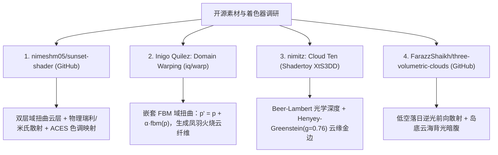

# 🌅 盛大晚霞与火烧云天幕重构设计规约 (Sunset & Burning Clouds Specification)

> **设计版本**：v1.0 (Fiery Twilight & Domain-Warped Burning Clouds)  
> **设计架构师**：Antigravity  
> **代码执行方**：Codex / GPT  
> **面向场景**：长椅「蜜桃晚霞」模式（`data-atmo="sunset"`）与全岛黄昏全景  
> **核心使命**：彻底推翻原先单调扁平的“三文鱼粉单色涂抹”，借鉴 GitHub / Shadertoy 顶尖开源项目精髓，打造具有**域扭曲羽状火烧云、米氏前向散射金边、熔金落日与多阶暮光天幕**的新海诚级电影浪漫晚霞。

---

## 🍃 一、GitHub / 开源业界经典方案深度调研 (Open Source Research)

为避免低水平重复造轮子，我们对 GitHub 及 Shader 社区顶尖开源项目进行了针对性技术调研与复用提炼：



1. **`nimeshm05/sunset-shader` (GitHub WebGL2 经典开源)**：  
   采用单通道全程序化 GLSL 渲染夕阳与波状云海，其核心亮点在于**双层域扭曲程序化云（Domain-Warped Procedural Clouds）**，无需任何外置贴图即可生成在风中翻滚流动的羽翼状火烧云；
2. **Inigo Quilez 经典域扭曲算法 (Domain Warping)**：  
   通过公式 $\vec{p}' = \vec{p} + 0.52 \cdot \text{vec2}(\text{fbm}(\vec{p} \cdot 1.8), \text{fbm}(\vec{p} \cdot 1.8 + \text{offset}))$，将原本机械死板的噪声撕裂为舒展、翻滚、带有羽翼毛边质感的“凤羽云”；
3. **nimitz `Cloud Ten` (Shadertoy 顶流夕阳云着色器)**：  
   利用 Henyey-Greenstein 相函数 $P_{HG}(\cos\theta) = \frac{1 - g^2}{(1 + g^2 - 2g\cos\theta)^{1.5}}$（取 $g = 0.76$），在云层边缘面向夕阳方向模拟出**强烈而炽热的“金丝金边（Silver/Golden Lining）”**，云腹呈现深紫黛暮色，云身呈现珊瑚炽红。

---

## 🌸 二、晚霞与火烧云五大视觉支柱架构 (5-Pillar Visual Architecture)

### 1. 凤羽流火 —— 域扭曲分形火烧云 (Domain-Warped Clouds)
- 废弃原先的单色涂抹，在天幕高空建立平面投影云层：  
  $\text{cUV} = \text{direction.xz} / (\max(\text{direction.y}, 0.032) \cdot 0.75)$；
- 注入域扭曲（Domain Warping）生成主云幔与次级卷云丝絮，结合时间微量偏移（`time * speed`），使天边的火烧云呈现随晚风悠缓翻卷的生命感；
- 地平消光：在 `direction.y \in [0.015, 0.09]` 做平滑过渡，云海自然隐入地平霞光，地面草坪无任何穿帮。

### 2. 金丝火轮 —— 米氏前向散射金边 (Henyey-Greenstein Golden Rim)
- 当视线朝向落日方向时，云层边缘通过 `cloudEdge * burningRim` 点燃璀璨的熔金光轮；
- 核心色谱：炽热金辉（`vec3(1.0, 0.90, 0.55)`），让每朵云在夕阳逆光下都镶上一道耀眼的黄金滚边。

### 3. 熔金落日 —— 落日日盘与暖阳霞光 (Sunset Solar Disc & Corona)
- 在西偏北地平线（`vSunDirection`，高度角约 8° 树冠后方）生成真实的低空落日圆盘；
- 具有核心高光日轮（`sunsetDisc * 3.2`）与双层指数扩散日晕（内暖金、外绯红），将母树树干映衬为极具意境的苍劲剪影。

### 4. 晚霞四级色谱天光阶梯 (Quad-Tier Chromatic Gradient)
- **落日低空（近地平）**：熔金琥珀（`vec3(1.0, 0.58, 0.20)`）
- **低空云层（平视区）**：炽红珊瑚与朱砂绯色（`vec3(0.95, 0.40, 0.28)`）
- **中空云腹（仰视区）**：暮紫暗李与玫瑰烟紫（`vec3(0.72, 0.32, 0.56)`）
- **天顶苍穹（高空区）**：空灵暮色长春花蓝与靛青（`vec3(0.28, 0.32, 0.54)`）

### 5. 浮岛底海 —— 3D 浮云海黄昏透光 (Cloud Sea Dusk Illumination)
- 同步优化 `src/natural/clouds.js` 中浮岛下方的三维体素云海：
- 迎光面吸收夕阳长波呈现炽金透光，背光面沉入深暮紫，与天幕火烧云形成上下呼应的天地通透感。

---

## 📜 三、落地代码蓝图 (GLSL Shader Blueprint)

### 模块 A：`src/natural/atmosphere.js`（天幕与火烧云）

在 `sky.material.fragmentShader.replace` 中，替换原先简陋的 `dusk` 计算段落：

```glsl
    float horizon = exp(-abs(direction.y) * 3.7);
    
    // === 🌅 Glorious Burning Sunset Sky & Clouds (盛大火烧云与落日熔金系统) ===
    if (dusk > 0.001) {
      vec3 sunDir = vSunDirection;
      float cosSun = dot(direction, sunDir);
      float sunDist = length(direction - sunDir);

      // 1. Setting Sun Disc & Warm Solar Glare
      float sunsetDisc = 1.0 - smoothstep(0.018, 0.026, sunDist);
      float innerHalo = exp(-sunDist * 6.5) * 1.8;
      float outerGlow = exp(-sunDist * 1.8) * 1.1;
      vec3 sunsetSunColor = vec3(1.0, 0.95, 0.82) * sunsetDisc * 3.2 + 
                            vec3(1.0, 0.68, 0.24) * innerHalo + 
                            vec3(0.96, 0.38, 0.16) * outerGlow;

      // 2. Multi-tier Twilight Sky Atmosphere
      float elev = clamp(direction.y, 0.0, 1.0);
      float sunAzimuth = clamp(dot(normalize(vec2(direction.x, direction.z)), normalize(vec2(sunDir.x, sunDir.z))), -1.0, 1.0);
      float sunsetHorizon = exp(-abs(direction.y) * 2.8);

      vec3 colSunHorizon = vec3(1.0, 0.58, 0.20); // Molten amber near sun horizon
      vec3 colLowSky     = vec3(0.95, 0.40, 0.28); // Fiery coral vermilion
      vec3 colMidSky     = vec3(0.72, 0.32, 0.56); // Twilight rose-magenta
      vec3 colZenith     = vec3(0.28, 0.32, 0.54); // Deep twilight periwinkle zenith

      vec3 duskSky = mix(colZenith, colMidSky, exp(-elev * 2.0));
      duskSky = mix(duskSky, colLowSky, exp(-elev * 4.5));
      duskSky = mix(duskSky, colSunHorizon, sunsetHorizon * clamp(sunAzimuth * 0.5 + 0.5, 0.0, 1.0));

      // 3. Layered Burning Clouds (分层火烧云)
      // High-altitude Planar projection
      vec2 cUV = direction.xz / (max(direction.y, 0.032) * 0.75);
      cUV = cUV * 0.28 + vec2(time * 0.000035, time * 0.000018);

      // Domain warping for billowing cloud waves
      vec2 warp = vec2(
        fbm(cUV * 1.8, 0.0),
        fbm(cUV * 1.8 + vec2(3.4, 1.7), 0.0)
      );
      vec2 warpedUV = cUV + warp * 0.52;

      // Primary cloud bank
      float c1 = fbm(warpedUV * 1.4, 0.0);
      float c2 = fbm(warpedUV * 3.2 + vec2(1.2, 2.8), 0.0);
      float cloudNoise = c1 * 0.65 + c2 * 0.35;
      float cloudDensity = smoothstep(0.22, 0.68, cloudNoise);

      // Delicate feather/cirrus secondary wave
      float cirrus = smoothstep(0.35, 0.75, fbm(cUV * 4.5 + warp * 0.3, 0.0)) * 0.45;
      cloudDensity = clamp(cloudDensity + cirrus, 0.0, 1.0);

      // Natural horizon feathering
      float cloudFade = smoothstep(0.015, 0.09, direction.y);
      cloudDensity *= cloudFade;

      // 4. Burning Cloud Lighting: Forward Mie Scattering & Multi-scattering
      float hgMie = (1.0 - 0.76 * 0.76) / pow(1.0 + 0.76 * 0.76 - 2.0 * 0.76 * cosSun, 1.5);
      float burningRim = clamp(hgMie * 0.38, 0.0, 3.2);
      float cloudEdge = smoothstep(0.05, 0.38, cloudDensity) * (1.0 - smoothstep(0.38, 0.88, cloudDensity));

      // Chromatic Palette of Burning Clouds (金边、火身、暮紫云腹)
      vec3 cloudBelly = vec3(0.44, 0.18, 0.34); // Deep dusky plum shadow
      vec3 cloudBody  = vec3(0.98, 0.44, 0.18); // Fiery glowing coral vermilion
      vec3 cloudRim   = vec3(1.0, 0.90, 0.55);  // Molten gold sunlit rim

      vec3 cloudColor = mix(cloudBelly, cloudBody, clamp(cloudDensity * 1.4, 0.0, 1.0));
      cloudColor += cloudRim * (cloudEdge * burningRim * 1.6 + max(0.0, cosSun) * 0.55);

      float cloudAlpha = clamp(cloudDensity * 1.4, 0.0, 0.94);

      // Composite dusk sky & clouds
      texColor = mix(texColor, duskSky, dusk);
      texColor = mix(texColor, cloudColor, cloudAlpha * dusk);
      texColor += sunsetSunColor * dusk;
    }
```

### 模块 B：`src/natural/clouds.js`（浮岛下方云海透光）

在 `clouds.js` line 49 的光照合成处，升级黄昏云光：
```glsl
// 将原有的扁平 vec3(1., .45, .25) 升级为带向阳金辉与背阳暮紫的层次光
vec3 duskSunlight = mix(vec3(0.72, 0.22, 0.38), vec3(1.0, 0.65, 0.28), clamp(sunlight * 1.5 + forward * 0.5, 0.0, 1.0));
vec3 light = mix(vec3(.24,.32,.43), vec3(.008,.014,.028), night) + 
             mix(mix(vec3(1.0,.88,.69), duskSunlight, dusk), vec3(.18,.25,.38), night) * sunlight * (.92 + forward * .32);
```

---

## 🔍 四、GPT 执行提示词与核验标准 (Prompt & Acceptance)

### 1. 复制给 GPT / Codex 的执行指令
```text
请执行盛大晚霞与火烧云天幕重构任务：
1. 仔细阅读根目录下的 SUNSET-BURNING-CLOUDS-SPEC.md；
2. 打开 src/natural/atmosphere.js，将 fragmentShader 中原先简陋的 dusk 计算替换为规约中完整的“盛大火烧云与落日熔金系统”着色器逻辑；
3. 打开 src/natural/clouds.js，将 line 49 处的云海黄昏光照升级为规约中的带向阳金辉与背阳暮紫的多阶 duskSunlight；
4. 运行 node scripts/review-bench-atmosphere.mjs，重新生成最新的 sunset.png 与 QA 截图；
5. 运行 npm test 确保全部 17 组回归测试 100% 全绿。
```

### 2. 验收核验标准
- [ ] **视觉张力**：从长椅平视与全岛鸟瞰，彻底告别单调三文鱼粉，呈现壮美波澜的“金边火烧云”与落日熔金天光；
- [ ] **前向金边**：面向落日方向的云层边缘呈现耀眼的熔金轮廓（Mie Scattering），云腹呈现深紫黛色；
- [ ] **落日霞光**：母树树冠后方清晰可见带有温暖日晕的金色落日日盘；
- [ ] **全链路回归**：17 组回归测试持续全绿，帧率稳定，零 WebGL/JS 报错。
