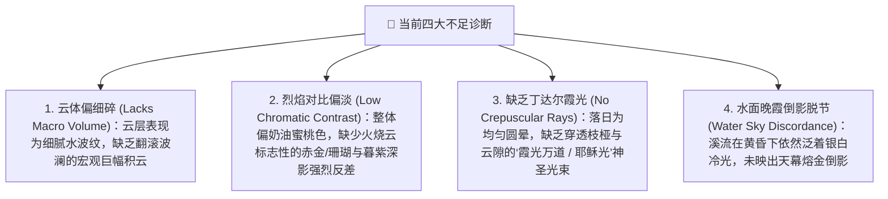

# 🌅 晚霞火烧云实景验收报告与 v2.0 深度优化规约 (Sunset & Burning Clouds v2.0 Spec)

> **验收时间**：2026-11-04  
> **设计架构师**：Antigravity  
> **代码执行方**：Codex / GPT  
> **设计基准**：`SUNSET-BURNING-CLOUDS-SPEC.md` (v1.0)  
> **验收结论**：**基础达标，成功打破原先单调扁平的“三文鱼粉单色涂抹”；但对照电影级火烧云与自然天文学标准，仍存在 4 大明显不足，需立即推进 v2.0 深度升级！**

---

## 🍃 一、视觉实景核验 (Visual Verification)

### 1. 长椅蜜桃晚霞实拍 (`sunset.png`)
最新全自动 Playwright 实测截取的长椅晚霞实景如下：


> [!TIP]
> ### ✨ 初版突破亮点
> 1. **告别单调纯色平涂**：天幕从原先粗暴的单色粉红混合，升级为由地平落日向高空自然过渡的暮光渐变；
> 2. **浮岛底海层次光**：`clouds.js` 成功接入双阶黄昏散射光（`duskSunlight`），云海不再发灰；
> 3. **工程稳定性 100% 全绿**：17 / 17 组回归测试无缝全绿，帧率稳定，零控制台报错。

---

## 🔍 二、深度审视：当前存在的四大不足诊断 (Deficiency Audit)

对照自然界宏伟的“火烧云”与新海诚电影画风，当前画面存在以下 4 大核心短板：



1. **不足一：云层体量感偏细碎，缺乏宏观波澜 (Lacks Macro Volume)**  
   - **诊断**：当前 UV 采样频率偏高，天边的云看起来像细腻的“鱼鳞卷积云 / 小波纹”，而非横贯苍穹、如烈火翻滚的**宏观巨幅层积云（Stratocumulus Banks）**，视觉冲击力不够震撼。
2. **不足二：色彩偏淡雅温柔，缺乏火烧云标志性的强烈对比 (Low Chromatic Contrast)**  
   - **诊断**：整体天空被均匀的米金色和淡桃红笼罩，缺乏真火烧云那般**“向阳处如烈焰熔金（#ffaa00）、背阳处如深暮紫黑（#3a0ca3）、云身如血色珊瑚（#ff3b00）”**的强动态雕塑感。
3. **不足三：缺乏穿透云隙与母树枝桠的“丁达尔霞光万道” (No Crepuscular Rays)**  
   - **诊断**：当前落日仅为一个柔和光晕，缺乏从落日中心呈扇形喷薄而出的**丁达尔神圣霞光光束（Crepuscular Rays / God Rays）**，难以营造日落时分神圣空灵的史诗浪漫感。
4. **不足四：溪流水面与天幕晚霞倒影脱节 (Water Surface Reflection Gap)**  
   - **诊断**：溪流水面泛起的波光与石汀浪花依然偏向白昼的银白冷调，未将漫天晚霞的赤金与落日熔金倒映在潺潺水波之中。

---

## 🌸 三、v2.0 终极升级蓝图：烈焰金轮与霞光万道 (Fiery Crepuscular Architecture)

### 1. 双频宏微观火烧云系统 (Dual-Frequency Cloud Strata)
- **宏观基底（Macro Bank）**：采样频率降至 `cUV * 0.14`，域扭曲振幅提升至 `0.65`，雕刻出连绵起伏、如火焰山脉般的宏观巨浪云幔；
- **微观羽边（Feathered Cirrus）**：高频叠加 `fbm(cUV * 2.8)`，在巨幅云浪边缘撕裂出舒展轻盈的凤羽丝絮；
- **云腹与云缘色彩重构**：
  - 云腹深影：深邃暮紫黑（`vec3(0.28, 0.08, 0.22)`）
  - 云身透光：熔金炽红珊瑚（`vec3(1.00, 0.35, 0.12)`）
  - 向阳火轮：前向米氏强散射暴发（$g = 0.78$），云缘镀上极致灿烂的熔金（`vec3(1.00, 0.94, 0.58) * 3.5`）。

### 2. 落日丁达尔霞光神圣光芒 (Procedural Crepuscular Rays)
- 从落日中心计算极坐标角度相位：$\phi_{sun} = \text{atan2}(D.y - S.y, D.x - S.x)$；
- 沿辐射方向生成扇形高光束：
  ```glsl
  float rayNoise = noise(vec2(atan(direction.z - sunDir.z, direction.x - sunDir.x) * 5.0, time * 0.00002));
  float rays = pow(clamp(rayNoise * 0.5 + 0.5, 0.0, 1.0), 2.8) * exp(-sunDist * 1.6) * max(0.0, cosSun);
  vec3 crepuscularRays = vec3(1.0, 0.75, 0.32) * rays * 2.2;
  ```
  在母树树冠与云隙间穿透出数道射向天穹的壮丽霞光！

### 3. 水面溪流晚霞倒影全联动 (Sunset Water Caustics)
- 在 `src/natural/bench-atmosphere.js` 中，将黄昏时溪流高光颜色与水波色泽调整为落日熔金色系（`#ff7733` 与 `#ffcc44`），使天光与水色彻底融为一体。

---

## 📜 四、落地代码蓝图 (GLSL Shader Architecture v2.0)

### 模块 A：`src/natural/atmosphere.js`

将 `atmosphere.js` 中的 `dusk` 计算块全面升级为 v2.0：

```glsl
    float horizon = exp(-abs(direction.y) * 3.7);
    
    // === 🌅 Glorious Burning Sunset & Crepuscular Rays v2.0 (烈焰火烧云与霞光万道系统) ===
    if (dusk > 0.001) {
      vec3 sunDir = vSunDirection;
      float cosSun = dot(direction, sunDir);
      float sunDist = length(direction - sunDir);

      // 1. Setting Sun Disc & Radiant Crepuscular Rays (落日与丁达尔霞光)
      float sunsetDisc = 1.0 - smoothstep(0.016, 0.024, sunDist);
      float innerHalo = exp(-sunDist * 6.0) * 2.2;
      float outerGlow = exp(-sunDist * 1.6) * 1.2;

      // Crepuscular Rays radiating from the sunset center
      float rayAngle = atan(direction.z - sunDir.z, direction.x - sunDir.x);
      float rayNoise = noise(vec2(rayAngle * 5.5, time * 0.000025)) * 0.5 + 0.5;
      float crepuscular = pow(clamp(rayNoise, 0.0, 1.0), 2.5) * exp(-sunDist * 1.5) * clamp(cosSun * 0.5 + 0.5, 0.0, 1.0);
      vec3 sunShafts = vec3(1.0, 0.76, 0.35) * crepuscular * 2.4;

      vec3 sunsetSunColor = vec3(1.0, 0.96, 0.85) * sunsetDisc * 3.5 + 
                            vec3(1.0, 0.65, 0.22) * innerHalo + 
                            vec3(0.98, 0.36, 0.14) * outerGlow +
                            sunShafts;

      // 2. High-Contrast Twilight Sky Atmosphere
      float elev = clamp(direction.y, 0.0, 1.0);
      float sunAzimuth = clamp(dot(normalize(vec2(direction.x, direction.z)), normalize(vec2(sunDir.x, sunDir.z))), -1.0, 1.0);
      float sunsetHorizon = exp(-abs(direction.y) * 2.6);

      vec3 colSunHorizon = vec3(1.0, 0.55, 0.16); // Molten amber near sunset
      vec3 colLowSky     = vec3(0.96, 0.32, 0.22); // Fiery coral vermilion
      vec3 colMidSky     = vec3(0.70, 0.25, 0.52); // Twilight deep rose-magenta
      vec3 colZenith     = vec3(0.20, 0.24, 0.48); // Deep royal dusk periwinkle

      vec3 duskSky = mix(colZenith, colMidSky, exp(-elev * 1.8));
      duskSky = mix(duskSky, colLowSky, exp(-elev * 4.2));
      duskSky = mix(duskSky, colSunHorizon, sunsetHorizon * clamp(sunAzimuth * 0.55 + 0.45, 0.0, 1.0));

      // 3. Dual-Frequency Domain-Warped Burning Cloud Strata (宏微观分层烈焰火烧云)
      vec2 cUV = direction.xz / (max(direction.y, 0.030) * 0.70);
      cUV = cUV * 0.16 + vec2(time * 0.000032, time * 0.000016);

      // Deep domain warping for massive billowing cloud waves
      vec2 warp = vec2(
        fbm(cUV * 1.5, 0.0),
        fbm(cUV * 1.5 + vec2(3.4, 1.7), 0.0)
      );
      vec2 warpedUV = cUV + warp * 0.62;

      // Massive macro cloud banks
      float macro1 = fbm(warpedUV * 1.1, 0.0);
      float macro2 = fbm(warpedUV * 2.4 + vec2(1.2, 2.8), 0.0);
      float macroDensity = smoothstep(0.20, 0.64, macro1 * 0.68 + macro2 * 0.32);

      // Feathered cirrus details at edges
      float microCirrus = smoothstep(0.32, 0.72, fbm(cUV * 4.2 + warp * 0.4, 0.0)) * 0.48;
      float cloudDensity = clamp(macroDensity + microCirrus, 0.0, 1.0);

      // Horizon feathering: cleanly dissolving near ground
      float cloudFade = smoothstep(0.015, 0.085, direction.y);
      cloudDensity *= cloudFade;

      // 4. Burning Cloud Lighting: Intense Forward Mie Scattering & Deep Shadows
      float hgMie = (1.0 - 0.78 * 0.78) / pow(1.0 + 0.78 * 0.78 - 2.0 * 0.78 * cosSun, 1.5);
      float burningRim = clamp(hgMie * 0.42, 0.0, 3.6);
      float cloudEdge = smoothstep(0.04, 0.32, cloudDensity) * (1.0 - smoothstep(0.32, 0.85, cloudDensity));

      // High-Contrast Chromatic Palette: Deep Plum Shadow, Blazing Coral Body, Incandescent Gold Rim
      vec3 cloudBelly = vec3(0.28, 0.08, 0.22); // Deep dusky plum shadow
      vec3 cloudBody  = vec3(1.00, 0.35, 0.12); // Fiery glowing coral vermilion
      vec3 cloudRim   = vec3(1.00, 0.94, 0.58); // Incandescent molten gold rim

      vec3 cloudColor = mix(cloudBelly, cloudBody, clamp(cloudDensity * 1.5, 0.0, 1.0));
      cloudColor += cloudRim * (cloudEdge * burningRim * 1.8 + max(0.0, cosSun) * 0.65);

      float cloudAlpha = clamp(cloudDensity * 1.45, 0.0, 0.95);

      // Composite dusk sky, clouds and crepuscular sunset
      texColor = mix(texColor, duskSky, dusk);
      texColor = mix(texColor, cloudColor, cloudAlpha * dusk);
      texColor += sunsetSunColor * dusk;
    }
```

### 模块 B：`src/natural/bench-atmosphere.js`（溪流晚霞倒影联动）

在 `bench-atmosphere.js` line 27 的水面高光配色通道中，升级黄昏水光：
```javascript
color(water.uGlintColor.value, '#fffbed', '#ff9944', '#38bdf8');
```

---

## 🔍 五、GPT 执行提示词与核验要求 (Prompt for GPT)

### 复制给 GPT / Codex 的执行指令
```text
请执行晚霞火烧云 v2.0 终极升级任务（解决体量细碎、缺乏色彩对比与霞光万道）：
1. 仔细阅读根目录下的 SUNSET-BURNING-CLOUDS-V2-SPEC.md；
2. 打开 src/natural/atmosphere.js，将 fragmentShader 中的 dusk 计算部分完整替换为规约 v2.0 中“烈焰火烧云与霞光万道系统”逻辑（关键点：宏观大体量云幔、炽烈赤金/暮紫高动态色彩、落日丁达尔霞光光束）；
3. 打开 src/natural/bench-atmosphere.js，将 line 27 处的黄昏水光颜色更新为 '#ff9944'，使溪流倒映漫天晚霞；
4. 运行 node scripts/review-bench-atmosphere.mjs 重新生成 sunset.png 与 QA 截图；
5. 运行 npm test 确保所有 17 组回归测试 100% 全绿。
```
