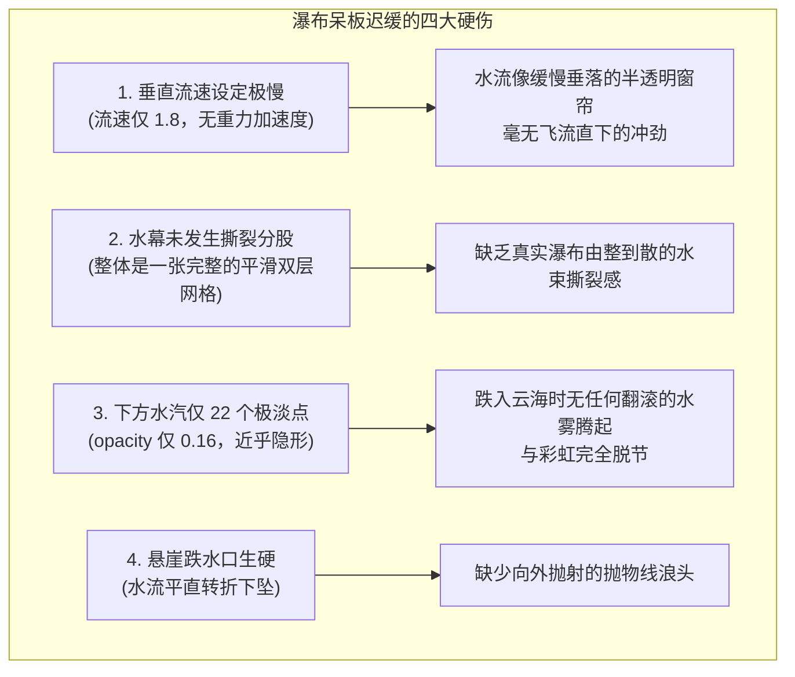
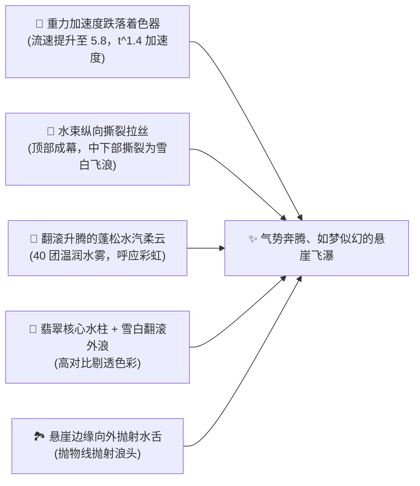

# 🌊 悬崖瀑布与跌水流动重塑设计规约 (Waterfall Liveliness & Cascade Spec)

> **设计方向**：彻底解决小岛边缘向下流水“像缓慢垂挂的半透明塑料布、缺乏重力冲劲与水汽飞溅”的问题  
> **设计架构师**：Antigravity  
> **代码执行方**：Codex / GPT  
> **工程基准文档**：`WATERFALL-LIVELINESS-SPEC.md`

---

## 🔍 一、当前小岛跌水“不够生动”的底层技术根因

经过深入核验 `src/natural/water.js` 中 `makeWaterfall` 的实现，悬崖瀑布显得呆滞迟缓的原因有四点：



---

## 🌊 二、「飞流直下·水汽氤氲」瀑布重塑方案 (Dynamic Cascade Architecture)



### 1. 🚀 重力加速度倾泻动力学 (Gravity Acceleration Shader)
- **垂直流速大幅提升**：着色器垂直滚动速度由原先迟缓的 `1.8` 大幅提升至 **`5.8 ~ 6.5`**；
- **重力加速度模拟**：随着下落距离（`vFallUv.y` 从 0 到 1），引入幂次加速度函数：
  $$\text{flowSpeed} = uTime \cdot 5.8 \cdot \left(1.0 + 0.65 \cdot \text{pow}(vFallUv.y, 1.4)\right)$$
  让水流呈现出在悬崖顶端起步、越往下落越飞速狂奔的真实重力下坠感！

### 2. 🌊 水束纵向撕裂与雪白飞浪 (Tearing Tendrils & Filaments)
- **顶部（$y \in [0, 0.25]$）**：厚重、连续、平滑的碧蓝水舌；
- **中段与下段（$y \in [0.25, 1.0]$）**：
  - 引入纵向拉伸的高频噪声，将水幕自然撕裂为一条条互相翻滚、交错奔腾的**雪白激流拉丝（White Water Filaments）**；
  - 边缘带有随风摇曳的不规则撕裂毛边（Ragged Edges），彻底告别平直几何边缘；
  - 材质中泡沫占比随下落急剧增加，水流在下坠中与空气剧烈混合，化作雪白的激浪条带。

### 3. 💨 翻滚升腾的蓬松水汽柔云团 (Billowing Spray & Mist Veil)
- **彻底废除 22 个隐形微粒**：
  - 在瀑布中下段与跌入云海交界处（$Y \in [-3.5, -1.8]$），构筑 **35~45 团蓬松的半透明水汽柔云（Billowing Spray Puffs）**；
  - 采用动态 Canvas 绘制的柔化径向水汽贴图（Soft Radial Smoke/Mist）；
  - 水汽团随微风向外缓缓扩散、翻滚膨胀并向上轻微升腾（`opacity: 0.38 ~ 0.52`）；
  - **彩虹交融**：水汽团恰好笼罩在场景既有的喷泉彩虹（`rainbow.js`）核心位置，阳光照耀下水汽折射出七彩斑斓的光晕，如梦如幻！

### 4. 💎 翡翠水芯与高光飞浪色彩 (High-Contrast Palette)
- **内层核心水柱（Inner Curtain）**：深邃剔透的翡翠碧蓝（`#0284c7` ~ `#059669`）；
- **外层飞溅白浪（Outer Curtain & Foam）**：极具光泽的晶莹纯白（`#ffffff`），带高光反射与微透光感；
- 形成外层白浪包裹着内层碧水的绝美层次感。

### 5. 🏞️ 悬崖边缘向外抛射水舌 (Parabolic Crest Lip)
- 优化顶点位置计算：在悬崖边缘跌落的第一段（$t \in [0, 0.25]$），水流依据冲出小溪的初速度，呈现微向外跃出的**抛物线水舌（Parabolic Arch）**，随后顺应重力垂直砸向云端。

---

## 📋 三、Codex / GPT 执行交付指令

```text
请阅读项目根目录下的 WATERFALL-LIVELINESS-SPEC.md 设计规约，彻底重塑小岛悬崖瀑布与跌水生动度：

1. 升级瀑布重力加速着色器（src/natural/water.js 中 makeWaterfall）：
   - 将垂直下泻速度从 1.8 提升至 5.8~6.5，并叠加重力加速度项（pow(uv.y, 1.4)）；
   - 中下段实现水幕撕裂分股：利用纵向拉伸噪声将水幕自然撕裂为翻滚奔腾的雪白激流条带（White Water Filaments），避免整张平滑窗帘感；
   - 悬崖顶端（uv.y < 0.25）赋予微向外跃出的抛物线水舌初速度；

2. 重构底部翻滚水汽群（Billowing Spray & Mist）：
   - 彻底废除仅 22 个单薄微粒，改为 40 团围绕瀑布中下部（y: -1.8 ~ -3.5）翻滚膨胀、升腾飘散的蓬松半透明水汽柔云团；
   - 提升水汽可见度（opacity: 0.38~0.48），与场景下方的喷雾彩虹形成光晕辉映；

3. 运行 npm test 确保所有回归测试通过，并运行 node scripts/review-overall-design.mjs 重新生成全景截图。
```
